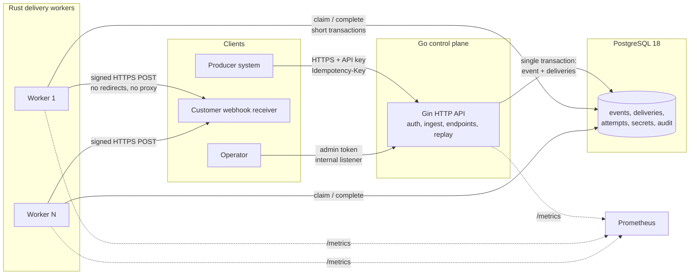

# RelayForge

[](https://github.com/gilangalfariqi/relayforge/actions/workflows/ci.yml)

Reliable, multi-tenant webhook and event delivery.

RelayForge accepts business events over an authenticated API, persists them durably, and atomically fans
each event out into per-endpoint delivery rows. The Rust delivery worker signs each request with
HMAC-SHA256, retries transient failures with bounded exponential backoff, records every attempt, and supports
authorised replay.

> **Status: Phases 1–7 implemented and locally verified; CI and image publishing green.** Delivery engine,
> SSRF enforcement, rate limits, retention, replay, admin API, fuzz/crash drills and a reduced-scale
> benchmark run exist, with executed evidence in the phase reports
> ([12](docs/12-phase-1-report.md)–[18](docs/18-phase-7-report.md)). Remaining limits (indicative-only
> benchmarks, CI checks narrower than the local evidence, no release tag) are in
> [docs/11-known-limitations.md](docs/11-known-limitations.md). Phase boundaries:
> [docs/08-implementation-plan.md](docs/08-implementation-plan.md).

### One-command demo

With the Compose stack running (`make up`), `make demo` runs a live walkthrough: signup, endpoint, ingest
(with idempotent replay), transient 503 and automatic retry, delivery, outage and dead-letter, authorised
replay, audit trail. A recorded run is in [bench/results/demo-output.txt](bench/results/demo-output.txt).

## Why this exists

Webhook delivery is deceptively hard. Naive implementations lose events when a process dies between a
database commit and a publish, deliver duplicates, retry permanent failures forever, allow one tenant to
reach another tenant's data, and let customer-controlled URLs reach internal networks. RelayForge treats
those as first-class design problems, not edge cases:

| Business problem | Design response |
| --- | --- |
| Destination unavailable or slow | Durable queue, per-attempt timeouts, bounded retries, dead-letter state |
| Repeated requests / duplicate operations | Required idempotency keys on ingest; stable event IDs; receivers deduplicate durably |
| Crash between commit and publish | Event and delivery rows are created in **one** PostgreSQL transaction; the commit is the publish |
| Concurrent workers processing one job | `FOR UPDATE SKIP LOCKED` claim + per-attempt lease token |
| Failed events need investigation and replay | Immutable attempt history, structured failure codes, authorised replay with a new cycle |
| Credential and signing-secret exposure | Hashed API keys, encrypted signing secrets, rotation with overlap, log redaction |
| Cross-tenant access | Tenant ID is part of every query; cross-tenant reads return `404`; isolation tests |
| SSRF via customer URLs | HTTPS-only, port allowlist, connect-time IP validation via a custom resolver, redirects and proxies disabled, egress isolation |
| No evidence of health or latency | Prometheus metrics, structured logs, traces, queue-age and failure-rate alerts, runbooks |
| Partial failures corrupt history | Explicit state machines, lease-guarded transitions, append-only attempts, derived event status |

## Architecture at a glance



The Go API and Rust worker share one PostgreSQL database and one versioned delivery contract
([contracts/delivery-contract-v1.md](contracts/delivery-contract-v1.md)). They do **not** call each other
on the delivery path. PostgreSQL is the queue; no Kafka or Redis is introduced without measured need
([ADR-0002](docs/adr/0002-postgres-as-queue.md)).

## Delivery semantics (stated precisely)

RelayForge provides **durable at-least-once** delivery. It does **not** promise exactly-once delivery to
an external endpoint, and it cannot: the receiver can process a request and lose the acknowledgement.
Event IDs are stable across retries; every delivery attempt carries a fresh timestamp and signature.
Receivers must persist an idempotency record keyed by `webhook-id` in the same transaction as their
business effect. The included demo receiver demonstrates that pattern.

## Quick start

Requires Docker with Linux containers. From the repository root:

```sh
docker compose -f deploy/compose.yaml up -d --build
curl -s http://localhost:8080/healthz
curl -s http://localhost:8080/readyz
curl -s http://localhost:9091/readyz
curl -s http://localhost:8080/api/v1/openapi.yaml | head -n 3
docker compose -f deploy/compose.yaml ps
```

The stack runs the Go API, Rust delivery worker, PostgreSQL, and the reference receiver. The migration
service runs once before the API and worker start. PostgreSQL is published on `127.0.0.1:55432` to avoid
collisions with a local server; the API is on `:8080`, its metrics on `127.0.0.1:9090`, the receiver on
`127.0.0.1:8090`, and the worker metrics on `127.0.0.1:9091`.

For a complete live walkthrough, run `make demo` after the stack is healthy. The full curl collection is in
[docs/19-curl-examples.md](docs/19-curl-examples.md).

### API smoke test (local only)

Compose runs with `RELAYFORGE_SIGNUP_MODE=open`, so anyone who can reach local port 8080 can create a
tenant. Do not expose this configuration. The API key is returned once; store it in a shell variable.

```sh
curl -sS -X POST http://localhost:8080/api/v1/tenants \
  -H 'Content-Type: application/json' \
  -d '{"name":"Demo","slug":"demo"}'
# Copy "api_key" from the response (it starts with rf_live_) into:
export RF_KEY='rf_live_...'

curl -sS -X POST http://localhost:8080/api/v1/endpoints \
  -H "Authorization: Bearer $RF_KEY" -H 'Content-Type: application/json' \
  -d '{"name":"receiver","url":"https://receiver:8090/webhook","event_types":["order.created"]}'

curl -sS -X POST http://localhost:8080/api/v1/events \
  -H "Authorization: Bearer $RF_KEY" -H 'Content-Type: application/json' \
  -H 'Idempotency-Key: demo-event-0001' \
  -d '{"type":"order.created","data":{"order_id":"ord_1"}}'
```

The endpoint URL must be HTTPS on an allowed port and must not resolve to a private or reserved address.
Compose sets `RELAYFORGE_ALLOW_INSECURE_LOCAL_DELIVERY=true` so the worker may reach the local demo
receiver over HTTP; that switch is for this stack only. In a real deployment, use a public HTTPS receiver.

Repeating the event request with the same key and body returns the same stored response and
`Idempotency-Replayed: true`. Stop with `docker compose -f deploy/compose.yaml down`. Add `-v` only if you
intend to delete the local database volume.

## CI/CD

- `.github/workflows/ci.yml` runs Go formatting, vet, staticcheck, race tests, govulncheck, Rust
  fmt/clippy/tests, migration up/down/up, PostgreSQL-backed Go and Rust integration tests, image builds, a
  live Compose end-to-end delivery test, and a full-history gitleaks scan.
- `.github/workflows/publish.yml` publishes `linux/amd64` API, worker, and receiver images to GHCR after the
  `ci` workflow succeeds on `main`. A `v*` tag publishes only if every required CI check on the tagged
  commit is green; the workflow reads the check runs and fails otherwise. Tags include the branch or
  semantic version, `sha-<commit>`, and `latest` for `main` builds only, so releasing an older commit never
  moves `latest`. Builds attach SBOM and provenance attestations.
- `.github/dependabot.yml` opens grouped weekly updates for Go, Cargo, GitHub Actions, Dockerfiles, and
  Compose images.
- `main` is protected: force pushes and deletions are blocked, and the six CI jobs (`Go control plane`,
  `Rust worker`, `PostgreSQL and integration`, `Container images`, `End-to-end delivery`, `Secret scan`) are
  required status checks. Direct pushes stay allowed, so a red run must be fixed forward and never
  force-pushed away.

The workflows are in the repository and have run green repeatedly; the latest verified state is
[commit `b589434`](https://github.com/gilangalfariqi/relayforge/commit/b589434f77856404b206b4083f1706b6da2a778f)
with [ci run 40082063336](https://github.com/gilangalfariqi/relayforge/actions/runs/40082063336) (Go, Rust,
PostgreSQL integration, image builds, live Compose E2E, gitleaks) and
[publish run 40082639334](https://github.com/gilangalfariqi/relayforge/actions/runs/40082639334) (api,
worker, receiver images at `ghcr.io/gilangalfariqi/relayforge/{api,worker,receiver}`). The first run —
commit [`a95cf07`](https://github.com/gilangalfariqi/relayforge/commit/a95cf077fae8d3e95b360bdc7ac78df55cdcebf7)
— passed the same suite in [ci run 40077250780](https://github.com/gilangalfariqi/relayforge/actions/runs/40077250780)
and [publish run 40077250807](https://github.com/gilangalfariqi/relayforge/actions/runs/40077250807). A
green badge is evidence for its commit, not a permanent guarantee; GHCR package visibility was not verified
from an unauthenticated client.

## Documentation map

| Document | Contents |
| --- | --- |
| [docs/00-requirements.md](docs/00-requirements.md) | Problem, users, assumptions, non-goals, prioritised requirements, SLO targets |
| [docs/01-architecture.md](docs/01-architecture.md) | Context, components, boundaries, data flow, transaction and failure-window analysis |
| [docs/02-data-model.md](docs/02-data-model.md) | ERD, schema, constraints, indexes, access paths, retention, RLS analysis |
| [contracts/delivery-contract-v1.md](contracts/delivery-contract-v1.md) | Versioned Go/Rust contract: states, leasing, retries, timeouts, replay |
| [contracts/signature-v1.md](contracts/signature-v1.md) | Canonical signing representation, headers, rotation, receiver verification |
| [docs/04-api-v1.md](docs/04-api-v1.md) | API surface, errors, pagination, idempotency, rate limits, curl examples |
| [docs/05-threat-model.md](docs/05-threat-model.md) | Assets, trust boundaries, STRIDE, SSRF design, residual risks |
| [docs/06-testing-strategy.md](docs/06-testing-strategy.md) | Test matrix, failure injection, fuzzing, CI evidence |
| [docs/07-benchmark-plan.md](docs/07-benchmark-plan.md) | Reproducible workload, metrics, query-plan analysis, reporting rules |
| [docs/08-implementation-plan.md](docs/08-implementation-plan.md) | Phases 0–7 with acceptance criteria |
| [docs/09-incident-recovery.md](docs/09-incident-recovery.md) | Runbook: stuck queue, leases, DB outage, secret compromise |
| [docs/10-research-sources.md](docs/10-research-sources.md) | Primary sources verified on 2026-10-22 |
| [docs/11-known-limitations.md](docs/11-known-limitations.md) | Explicit v1 limits and unproven claims |
| [docs/12-phase-1-report.md](docs/12-phase-1-report.md) | Phase 1 files, executed commands, results, and gaps |
| [docs/13-phase-2-report.md](docs/13-phase-2-report.md) | Phase 2 files, executed commands, results, and gaps |
| [docs/14-phase-3-report.md](docs/14-phase-3-report.md) – [docs/16-phase-5-report.md](docs/16-phase-5-report.md) | Delivery engine, security/operations, validation evidence |
| [docs/17-phase-6-report.md](docs/17-phase-6-report.md) | Benchmarks, query plans, one adopted and one rejected optimization |
| [docs/18-phase-7-report.md](docs/18-phase-7-report.md) | Release checks, demo, documentation sync |
| [docs/19-curl-examples.md](docs/19-curl-examples.md) | Copy-paste curl collection for every public and internal operation |
| [SECURITY.md](SECURITY.md) | Supported versions, private vulnerability reporting, scope, safe harbour |
| [docs/adr/](docs/adr/) | Architectural decisions and rejected alternatives |
| [contracts/event-envelope-v1.json](contracts/event-envelope-v1.json) | Ingest envelope JSON Schema |

## Repository layout

```text
relayforge/
├── api/                    # Go module: cmd/api, cmd/migrate, internal/
│   ├── migrations/         # versioned SQL, owned by the control plane
│   └── openapi/            # embedded OpenAPI 3.1 document
├── worker/                 # Rust crate: relayforge-worker
│   └── scripts/            # container-based fmt/clippy/test helpers
├── contracts/              # Go↔Rust contract, signature spec, SSRF vectors
├── deploy/                 # Compose, Prometheus config
├── docs/                   # architecture, ADRs, reports, runbooks
├── .github/workflows/      # CI (actions pinned to commit SHAs)
├── Makefile
└── README.md
```

Also present: `bench/` (preload, EXPLAIN, k6 script, results), `api/cmd/bench` (load driver),
`api/cmd/demo` (walkthrough), `api/cmd/receiver` (reference webhook receiver).

## Toolchain baseline (verified 2026-10-22)

| Component | Version | Rationale |
| --- | --- | --- |
| Go | 1.27.3 | Current stable with 2026-10-19 security fixes; 1.27 and 1.26 are supported |
| Rust | 1.99.1 | Current stable; edition 2024 |
| PostgreSQL | 18.6 | Current supported major with native `uuidv7()`; 19 is still RC |
| Gin | v1.12.0 | Requested HTTP framework |
| pgx | v5.11.0 | Requested PostgreSQL driver |
| Axum | 0.8.9 | Worker health/metrics listener only |
| SQLx | 0.9.0 | Compile-time checked queries; MSRV 1.94 |
| reqwest | 0.13.5 | Custom DNS resolver support required for connect-time SSRF checks |

Exact patch versions are pinned in Phase 1. Sources are listed in
[docs/10-research-sources.md](docs/10-research-sources.md).

## Local environment facts (Phase 1, 2026-10-22)

- `W:\forgerelay` is now a git repository on branch `main`. Nothing has been committed yet.
- Go 1.27.3 is installed at `C:\Users\gilan\sdk\go1.27.3\go` and added to the user `PATH`.
- Rust/Cargo are **not installed natively**. Formatting, clippy, tests, and the release build were run in
  the pinned `rust:1.99.1-bookworm` container. This is a documented environment deviation, not a claim
  that a native toolchain exists.
- Docker Desktop's Linux engine is running (server 29.5.2). PostgreSQL 18.6 runs as a container.
- `psql` is not on the Windows `PATH`; schema checks used `docker exec ... psql`.
- Host port 5432 was unavailable, so Compose publishes PostgreSQL on `127.0.0.1:55432`.
- `go test -race` requires cgo and was executed in a `golang:1.27.3` Linux container; the Windows host has
  no C compiler.

A benchmark has been run only at reduced scale and is indicative; see
[docs/17-phase-6-report.md](docs/17-phase-6-report.md). CI has not run on GitHub; its YAML was parsed locally and the equivalent
commands were executed locally.

## Non-goals

RelayForge is not a general message broker, an analytics pipeline, a workflow engine, a UI product, or a
guarantee of exactly-once side effects. See the explicit non-goals in
[docs/00-requirements.md](docs/00-requirements.md).
