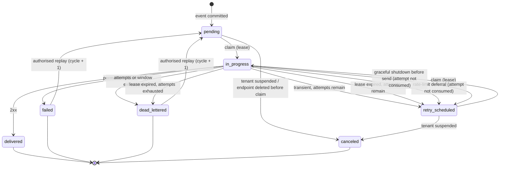

# RelayForge delivery contract v1

Status: proposed, Phase 0. Last updated: 2026-10-22.
Owner: architecture. Consumers: Go control plane, Rust delivery worker, integration tests, demo receiver.

This document is normative for both services. If code and this document disagree, the code is wrong.
Breaking changes require a new contract version (`v2`) and a migration plan; additive, backward-compatible
changes require review by both service owners and a contract test update.

## 1. Scope and versioning

Contract version: **1**.
Database schema version: **1** (managed by `golang-migrate`, table `schema_migrations`).

The contract covers:

1. Shared table/column semantics used by both services.
2. Delivery and attempt state machines and legal transitions.
3. Claim, lease, recovery, and completion algorithms.
4. Failure classification, retry policy, timeouts, and dead-letter rules.
5. Replay semantics.
6. Graceful shutdown behaviour.
7. Schema-version compatibility.

It does **not** define the public HTTP API (see [API v1](../docs/04-api-v1.md)) or the signature wire
format (see [signature v1](signature-v1.md), which is part of this contract by reference).

### 1.1 Compatibility rules

- Additive columns must have a default or be nullable and must not change existing semantics.
- The worker reads only columns named here. It must not depend on column order.
- The worker requires `schema_migrations.version >= RELAYFORGE_REQUIRED_SCHEMA_VERSION` and
  `dirty = false`. It fails readiness (not liveness) otherwise.
- Deploy order: migrate → control plane → worker. A worker refuses to claim when the schema is behind.
- Removing or renaming a column requires a two-release sequence: stop reading, then drop.
- Enum-like `text` values are part of this contract. Adding a value requires updating the `CHECK`
  constraint and both services' exhaustive matches.

## 2. Shared data semantics used by the worker

The authoritative schema is in [docs/02-data-model.md](../docs/02-data-model.md). The worker depends on:

| Table / column | Meaning |
| --- | --- |
| `deliveries.id` | Stable delivery identifier; sent as `RelayForge-Delivery` |
| `deliveries.event_id` | Stable event identifier; sent as `webhook-id` |
| `deliveries.endpoint_id` | Destination; secrets and URL resolved from here |
| `deliveries.cycle` | Replay generation, starts at 1 |
| `deliveries.cycle_started_at` | Retry-window anchor; reset on replay |
| `deliveries.status` | See state machine |
| `deliveries.attempt_count` | Consumed attempts in this cycle; decremented on rate-limit deferral |
| `deliveries.attempt_seq` | Monotonic claim sequence in this cycle; never decremented |
| `deliveries.max_attempts` | Policy snapshot |
| `deliveries.initial_backoff_ms`, `max_backoff_ms` | Policy snapshot |
| `deliveries.retry_window_seconds` | Policy snapshot |
| `deliveries.timeout_ms` | Policy snapshot |
| `deliveries.next_attempt_at` | Claim eligibility |
| `deliveries.lease_token` | Fencing token for completion |
| `deliveries.lease_expires_at` | Recovery deadline |
| `events.wire_body` | Exact bytes to sign and send; never re-serialised |
| `events.id` | `webhook-id` |
| `endpoints.url` | Destination |
| `endpoint_secrets` | Active secrets, decrypted at attempt time |

Units: all times are UTC `timestamptz`; all durations are milliseconds unless a column ends in
`_seconds`. Timestamps have microsecond precision; the worker truncates the signature timestamp to whole
seconds.

## 3. Delivery state machine



### 3.1 Transition table

| From | To | Trigger | Guard | Side effects |
| --- | --- | --- | --- | --- |
| — | `pending` | Ingest fan-out | Event transaction commits | Attempt history empty, `cycle=1` |
| `pending`, `retry_scheduled` | `in_progress` | Claim | `next_attempt_at <= now()`, row unlocked | `attempt_count+1`, `attempt_seq+1`, new `lease_token`, attempt row inserted |
| `in_progress` | `delivered` | Completion | `lease_token` matches, `status='in_progress'` | Attempt `success`; `completed_at=now()`; event projection |
| `in_progress` | `failed` | Completion | same | Attempt `permanent_failure`; `last_error_code`; event projection |
| `in_progress` | `retry_scheduled` | Completion | same, attempts remain, window remains | Attempt `retryable_failure`/`timeout`; `next_attempt_at` computed |
| `in_progress` | `dead_lettered` | Completion | same, attempts exhausted or window exhausted | Attempt recorded; `dead_lettered_at`; event projection |
| `in_progress` | `retry_scheduled` | Reaper | `lease_expires_at < now()`, attempts remain | Attempt `abandoned`; lease cleared; backoff computed |
| `in_progress` | `dead_lettered` | Reaper | lease expired, attempts exhausted | Attempt `abandoned`; `dead_lettered_at` |
| `in_progress` | `retry_scheduled` | Rate-limit deferral | Denied by destination limiter | Attempt `rate_limited`; `attempt_count-1`; lease cleared; retry at window end |
| `in_progress` | `retry_scheduled` | Shutdown before send | No HTTP started | Attempt `canceled`; `attempt_count-1`; lease cleared; retry soon |
| `pending`, `retry_scheduled` | `canceled` | Tenant suspension / endpoint delete | No active lease | `completed_at`; attempt history untouched |
| `failed`, `dead_lettered` | `pending` | Replay | Role owner/admin, tenant match, one cycle increment | `cycle+1`, `attempt_count=0`, `attempt_seq=0`, `cycle_started_at=now()` |
| any terminal | (none) | Direct update | — | Forbidden; all updates guard current status |

Illegal transitions return zero affected rows, never an exception that could be retried blindly. The
caller must treat zero rows as “lease lost or state changed” and discard its result.

### 3.2 Attempt outcomes

| Outcome | Meaning | Consumes attempt | Terminal for delivery |
| --- | --- | --- | --- |
| `success` | 2xx | Yes | `delivered` |
| `retryable_failure` | Transient HTTP/network status | Yes | No |
| `permanent_failure` | Non-retryable status or policy rejection | Yes | `failed` |
| `timeout` | Connect/read/total timeout | Yes | No (or dead-letter if exhausted) |
| `blocked` | SSRF policy rejected the destination | Yes | `failed` (`destination_blocked`) |
| `rate_limited` | Local/global limiter denied before send | **No** | No |
| `abandoned` | Worker lost the lease / crashed | Yes (already counted at claim) | No |
| `canceled` | Shutdown or suspension before send | **No** | No |

Attempt rows are inserted with `finished_at = NULL` at claim. Exactly one of the outcomes is written at
completion. `finished_at` is never updated twice; the completion `UPDATE` includes `finished_at IS NULL`.

## 4. Claim algorithm (normative)

The worker claims at most `WORKER_CLAIM_BATCH` due deliveries in one short transaction. The SQL below is
the contract. Implementations may format it differently but must preserve the locking semantics.

```sql
WITH due AS (
    SELECT id
    FROM deliveries
    WHERE status IN ('pending', 'retry_scheduled')
      AND next_attempt_at <= now()
    ORDER BY next_attempt_at, id
    FOR UPDATE SKIP LOCKED
    LIMIT $1
), leased AS (
    UPDATE deliveries d
       SET status         = 'in_progress',
           lease_token    = gen_random_uuid(),
           lease_expires_at = now() + make_interval(secs => $2),
           worker_id      = $3,
           attempt_count  = d.attempt_count + 1,
           attempt_seq    = d.attempt_seq + 1,
           updated_at     = now()
      FROM due
     WHERE d.id = due.id
    RETURNING d.*
), attempt AS (
    INSERT INTO delivery_attempts
        (tenant_id, delivery_id, cycle, attempt_no, started_at, worker_id)
    SELECT tenant_id, id, cycle, attempt_seq, now(), worker_id
    FROM leased
    RETURNING delivery_id
)
SELECT l.id, l.tenant_id, l.event_id, l.endpoint_id, l.cycle,
       l.cycle_started_at, l.attempt_count, l.attempt_seq,
       l.max_attempts, l.initial_backoff_ms, l.max_backoff_ms,
       l.retry_window_seconds, l.timeout_ms,
       l.lease_token, l.lease_expires_at
FROM leased l;
```

Properties:

- `SKIP LOCKED` prevents waiting on rows another worker holds. PostgreSQL documents that this gives an
  inconsistent view and is suitable for queue-like access, not general queries.
- `ORDER BY next_attempt_at, id` prefers overdue work, but the engine does **not** promise FIFO across
  workers or endpoints.
- The attempt row is inserted in the same transaction as the lease. If the transaction fails, neither
  exists.
- `attempt_count` and `attempt_seq` are incremented together. `attempt_seq` scopes the attempt row and is
  never decremented, which makes rate-limit deferral safe.
- The transaction ends before any DNS or HTTP work.
- A worker must not claim more than its free execution slots plus a small buffer. Claiming without a slot
  creates leases it cannot honour.

### 4.1 Lease duration

`lease_expires_at = now() + WORKER_LEASE_SECONDS`. Validation requires:

```text
WORKER_LEASE_SECONDS >= max(endpoint.timeout_ms)/1000 + 30
WORKER_LEASE_SECONDS between 60 and 300
```

The maximum allowed endpoint timeout is 30 s, so the default lease of 90 s is sufficient. There is no
heartbeat in v1; if the maximum timeout increases, a heartbeat or a longer lease must be added with a
contract change.

## 5. Completion algorithm (normative)

All state changes for one attempt occur in one short transaction, after the HTTP request has finished.

```sql
-- 1) Fence on the lease. Zero rows means the worker lost the lease.
UPDATE deliveries
   SET status            = $3,
       lease_token       = NULL,
       lease_expires_at  = NULL,
       worker_id         = NULL,
       next_attempt_at   = COALESCE($4, next_attempt_at),
       last_error_code   = $5,
       last_error_detail = $6,
       last_http_status  = $7,
       completed_at      = CASE WHEN $3 IN ('delivered','failed','dead_lettered')
                                THEN now() ELSE NULL END,
       dead_lettered_at  = CASE WHEN $3 = 'dead_lettered' THEN now() ELSE NULL END,
       updated_at        = now()
 WHERE id = $1
   AND lease_token = $2
   AND status = 'in_progress'
RETURNING id, event_id, attempt_count, attempt_seq, cycle;

-- 2) Only if step 1 returned one row:
UPDATE delivery_attempts
   SET finished_at   = now(),
       outcome       = $8,
       http_status   = $7,
       error_code    = $5,
       error_detail  = $6,
       duration_ms   = $9
 WHERE delivery_id = $1
   AND cycle = $10
   AND attempt_no = $11
   AND finished_at IS NULL;
```

If step 1 returns zero rows, the transaction is rolled back (or committed with no changes) and the
worker logs `lease_lost` with the delivery ID. It must not write the attempt outcome: the reaper owns the
abandoned attempt at that point. It must not retry the completion with a stale token.

`last_error_detail` is at most 512 characters, stripped of control characters, and must not contain
secrets, full payloads, or headers. HTTP status is stored even for retryable failures.

### 5.1 Event status projection

After a delivery reaches `delivered`, `failed`, or `dead_lettered`, the worker updates the event
projection in the same transaction:

```sql
SELECT id FROM events WHERE id = $1 FOR UPDATE;

UPDATE events e
   SET status = CASE
         WHEN s.pending > 0        THEN 'delivering'
         WHEN s.delivered = s.total THEN 'delivered'
         WHEN s.delivered > 0       THEN 'partially_delivered'
         WHEN s.failed = s.total    THEN 'failed'
         ELSE e.status
       END,
       updated_at = now()
  FROM (
      SELECT count(*) AS total,
             count(*) FILTER (WHERE status = 'delivered') AS delivered,
             count(*) FILTER (WHERE status IN ('failed','dead_lettered','canceled')) AS failed,
             count(*) FILTER (WHERE status IN ('pending','in_progress','retry_scheduled')) AS pending
      FROM deliveries
      WHERE event_id = $1
  ) s
 WHERE e.id = $1
   AND s.total > 0;
```

The event row lock serialises concurrent terminal transitions for the same event. The lock order is
always delivery row → event row; no code path takes the event lock before a delivery lock, which avoids a
lock cycle. `events.status` is a projection; `deliveries` is authoritative. Reconciliation is a runbook
procedure.

`accepted` means no attempt has completed yet. The first completion always makes at least one delivery
non-terminal or terminal, so the projection moves to `delivering` or a terminal state.

## 6. Lease recovery (normative)

The reaper runs on every worker (or on a single elected worker; either is safe because of `SKIP LOCKED`).
It runs every `WORKER_REAP_INTERVAL_SECONDS` (default 15) and processes at most
`WORKER_REAP_BATCH` (default 100) expired leases per tick.

Phase 1 — select and lock expired rows (short transaction):

```sql
SELECT id, tenant_id, event_id, cycle, attempt_count, attempt_seq,
       cycle_started_at, max_attempts, initial_backoff_ms,
       max_backoff_ms, retry_window_seconds
FROM deliveries
WHERE status = 'in_progress'
  AND lease_expires_at < now()
ORDER BY lease_expires_at
FOR UPDATE SKIP LOCKED
LIMIT $1;
```

Phase 2 — within the same transaction, for each row compute the outcome with the policy in §7, then:

```sql
UPDATE delivery_attempts
   SET finished_at  = now(),
       outcome      = 'abandoned',
       error_code   = 'lease_expired',
       error_detail = 'lease expired before completion'
 WHERE delivery_id = $1
   AND cycle = $2
   AND attempt_no = $3
   AND finished_at IS NULL;

UPDATE deliveries
   SET status           = $4,             -- retry_scheduled | dead_lettered
       next_attempt_at  = $5,
       lease_token      = NULL,
       lease_expires_at = NULL,
       worker_id        = NULL,
       last_error_code  = 'lease_expired',
       last_error_detail = 'lease expired before completion',
       completed_at     = CASE WHEN $4 = 'dead_lettered' THEN now() ELSE NULL END,
       dead_lettered_at = CASE WHEN $4 = 'dead_lettered' THEN now() ELSE NULL END,
       updated_at       = now()
 WHERE id = $1
   AND status = 'in_progress'
   AND lease_expires_at < now();
```

No HTTP occurs while these rows are locked. If the update affects zero rows, another reaper won the race;
that is safe.

The reaper must also handle a delivery in `in_progress` whose attempt row is missing (a bug or a partial
manual operation): insert an `abandoned` attempt with `attempt_no = attempt_seq` if absent, using
`ON CONFLICT DO NOTHING`, then transition the delivery. This is a reconciliation path, covered by a test.

## 7. Failure classification and retry policy (single source of truth)

Only the Rust `policy` module implements this table. Go stores policy values and reads outcomes; it does
not compute backoff or classify statuses.

### 7.1 HTTP status classification

| Response | Retryable | Error code | Notes |
| --- | --- | --- | --- |
| `200–299` | No (success) | — | Any 2xx counts, including 204/205 |
| `300–399` | No | `http_redirect` | Redirects are disabled; a 3xx is a failed delivery, not followed |
| `400` | No | `http_400` | Malformed request or schema disagreement |
| `401`, `403` | No | `http_401` / `http_403` | Configuration/authorisation problem; needs human action |
| `404`, `405`, `410` | No | `http_404` / `http_405` / `http_410` | Wrong URL or removed endpoint |
| `408` | **Yes** | `http_408` | Request timeout |
| `409` | No | `http_409` | Business conflict; retrying identical bytes will not resolve it |
| `413`, `414`, `415` | No | `http_413` / `http_414` / `http_415` | Payload/URL/type rejected |
| `421`, `422`, `423`, `424`, `426`, `428`, `431`, `451` | No | `http_4xx` | All remaining explicit 4xx |
| `425` | **Yes** | `http_425` | Too early |
| `429` | **Yes** | `http_429` | Honour `Retry-After` as a floor |
| Other `4xx` | No | `http_4xx` | Conservative: unknown client errors are permanent |
| `500`, `502`, `503`, `504`, `507` | **Yes** | `http_5xx` | Server-side/transient |
| `501`, `505`, `506`, `508`, `510`, `511` | No | `http_5xx_permanent` | Capability/loop/network-policy problem |
| Other `5xx` | **Yes** | `http_5xx` | Bounded by attempts; unknown 5xx treated as transient |
| `1xx` | No | `unexpected_status` | Should not surface from the client; defensive |

Rationale for treating 409 as permanent: a webhook payload is immutable across retries. If the receiver
returns 409 for the same bytes, retrying without operator intervention is unlikely to help. A tenant can
replay after fixing the receiver, which is an explicit action.

### 7.2 Transport and policy outcomes

| Condition | Retryable | Error code |
| --- | --- | --- |
| DNS resolution failure | Yes | `dns_error` |
| Connection refused / host unreachable / reset before response | Yes | `connect_error` |
| Connect timeout (includes DNS budget) | Yes | `connect_timeout` |
| Read timeout after request sent | Yes | `read_timeout` |
| Total attempt timeout | Yes | `total_timeout` |
| TLS certificate/handshake verification failure | No | `tls_error` |
| Destination rejected by SSRF policy at connect time | No | `destination_blocked` |
| Invalid URL at delivery time | No | `invalid_destination` |
| No active signing secret | No | `no_active_secret` |
| Secret decryption failure (KEK mismatch) | Yes, bounded | `internal_error` |
| HMAC construction failure | Yes, bounded | `internal_error` |
| Response body exceeds 8 KiB | No (status still used) | — |

TLS verification failures are permanent because automatic retries cannot repair an expired, mismatched,
or untrusted certificate. This is a deliberate trade-off: fixing the certificate and replaying is an
operator action, not an infinite retry loop.

`Retry-After` parsing:

- Integer delta-seconds: accepted if `0 <= value <= 86400`.
- HTTP-date: accepted if parseable; converted to a non-negative delta.
- Anything else: ignored.
- Effective value is clamped to `[1, 3600]` seconds and used as a **floor**:
  `delay_ms = max(backoff_ms, retry_after_ms)` then capped at `max_backoff_ms`.

### 7.3 Backoff

Definitions:

```text
attempts_made = delivery.attempt_count        (after the failed attempt)
raw_ms        = initial_backoff_ms * 2^(attempts_made - 1)
capped_ms     = min(raw_ms, max_backoff_ms)
jittered_ms   = capped_ms / 2 + U[0, capped_ms / 2)     (equal jitter)
delay_ms      = max(jittered_ms, retry_after_ms)         (429 only)
```

Equal jitter is chosen over full jitter to keep a predictable lower bound while still spreading retries.
Delays are computed from `now()` at completion, not from the previous schedule.

With defaults (`initial=5000 ms`, `max=3600000 ms`, `max_attempts=8`):

| Failed attempt | Raw base | Actual delay range |
| --- | --- | --- |
| 1 | 5 s | 2.5–5 s |
| 2 | 10 s | 5–10 s |
| 3 | 20 s | 10–20 s |
| 4 | 40 s | 20–40 s |
| 5 | 80 s | 40–80 s |
| 6 | 160 s | 80–160 s |
| 7 | 320 s | 160–320 s |
| 8 | — | Dead-letter (attempts exhausted) |

At `max_attempts = 20`, the cap binds from attempt 11.

### 7.4 Dead-letter rules

A delivery becomes `dead_lettered` when any of the following is true after a failed attempt:

1. `attempt_count >= max_attempts`.
2. `now() + delay > cycle_started_at + retry_window_seconds`.
3. The reaper finds an expired lease with `attempt_count >= max_attempts`.

Permanent failures become `failed` immediately, not `dead_lettered`. Both are replayable and both stop
retrying. A missing active secret is `failed` (`no_active_secret`), because automatic retries cannot
create one.

## 8. Timeouts

| Timeout | Default | Maximum | Enforcement |
| --- | --- | --- | --- |
| Connect (including DNS) | 3 s | 3 s | reqwest connect timeout + resolver budget |
| Read (per read operation) | 10 s | 10 s | reqwest read timeout |
| Total attempt | 15 s | 30 s | `tokio::time::timeout` around the whole request, including body drain |
| Response body read | 8 KiB cap | 8 KiB | Stream and discard; do not buffer beyond cap |
| Lease | 90 s | 300 s | Validated against max endpoint timeout |

The total timeout is authoritative. If connect plus read would exceed it, the total timeout fires first
and the outcome is `total_timeout`. Endpoint-level `timeout_ms` may lower the total; it may not raise it
above 30 s.

Response bodies are not stored and not logged. Only status, headers required for `Retry-After`, and
duration are used.

## 9. Replay semantics (normative)

Replay is allowed only for `failed` and `dead_lettered` deliveries. Delivered deliveries are not
replayable in v1 (that would intentionally create a duplicate without a failure to recover).

Within one transaction:

1. Authenticate and authorise (`owner` or `admin`) and verify tenant ownership.
2. Lock the delivery row (`SELECT ... FOR UPDATE`).
3. Verify status is `failed` or `dead_lettered`; otherwise record a skipped result.
4. Increment `cycle`, reset `attempt_count=0`, `attempt_seq=0`, `cycle_started_at=now()`,
   `next_attempt_at=now()`, clear lease/completion/dead-letter/error fields.
5. Insert an audit row with actor, reason, event ID, delivery ID, previous and new cycle.
6. Recompute the event projection (`delivering`).

Replay does not create a new event, does not change `webhook-id`, and does not delete old attempts. The
new attempt rows use the new cycle, so `UNIQUE (delivery_id, cycle, attempt_no)` remains valid.

Concurrent replays: the second transaction sees `pending` and skips with `409 not_replayable`. A replay of
a delivery that is currently `in_progress` is rejected; the caller may retry after it terminates.

Replay does not bypass the destination rate limit or SSRF policy. It re-runs both.

## 10. Graceful shutdown

On `SIGTERM`/`SIGINT`:

1. Set `shutting_down = true`; `/readyz` returns 503.
2. Stop the claim loop and stop acquiring new rate-limit tokens.
3. Cancel pending DNS/HTTP work at the configured deadline (`WORKER_SHUTDOWN_GRACE_SECONDS`, default 25).
4. For each delivery with a lease where HTTP was **not** started: in one transaction, mark the attempt
   `canceled`, set `attempt_count = attempt_count - 1` (not consumed), clear the lease, and set
   `next_attempt_at = now() + 1s`.
5. For HTTP that was started and completed: attempt normal completion if the database is reachable.
6. For HTTP aborted by the deadline: mark the attempt `canceled`, do **not** decrement `attempt_count`
   (the receiver may have processed it), clear the lease, schedule a retry. This is a duplicate window,
   documented in §12.
7. Close the SQLx pool after in-flight completion attempts. Exit 0 if cleanup succeeded, 1 otherwise.

If the process is killed with `SIGKILL`, step 4–7 do not happen; the reaper recovers after lease expiry.
The attempt remains `abandoned`, and the consumed attempt is not refunded. This is deliberate: a crash is
evidence that the attempt was claimed, and refunding it would allow unbounded retries under a crash loop.

## 11. Go/Rust schema compatibility check

Worker startup and readiness:

```sql
SELECT version, dirty
FROM schema_migrations
ORDER BY version DESC
LIMIT 1;
```

- No row: not ready (`schema_missing`).
- `dirty = true`: not ready (`schema_dirty`); requires operator intervention.
- `version < RELAYFORGE_REQUIRED_SCHEMA_VERSION`: not ready (`schema_behind`).
- `version >` compiled-in maximum: ready for reads but log a warning (`schema_ahead`); refuse to claim to
  avoid writing against an unknown schema. This is a deliberate fail-closed choice during rollback.

The control plane applies migrations as a separate command (`relayforge-api migrate up`) before serving.

## 12. Duplicate windows and receiver obligation

At-least-once delivery is a product semantic. Duplicates are possible when:

- the receiver processes a request and the response is lost (F7);
- the worker crashes after sending but before committing completion (F6);
- the completion commit fails and the lease expires (F8);
- the reaper wins a race with a slow worker (F9);
- shutdown aborts an in-flight request (step 6 above);
- an operator replays a failed delivery.

The receiver must:

1. Verify the signature over the raw body.
2. Reject timestamps outside ±300 s.
3. Persist `webhook-id` in a durable idempotency table, unique per receiver, **in the same transaction as
   the business effect**.
4. Return `2xx` for an authentic duplicate; do not repeat the effect.
5. Return `5xx`/`429` only when it wants a retry; do not return `2xx` before the effect is durable.

## 13. Contract test requirements

The following are mandatory before this contract is considered implemented:

- Claim concurrency: N goroutines/tasks claim the same 100 rows; union of claims has no duplicates and
  each claimed row has one attempt row.
- Lease expiry: a claimed row whose worker disappears is recovered; attempt becomes `abandoned`; retry is
  scheduled or dead-lettered per policy.
- Stale completion: completing with an old lease token affects 0 rows and writes no attempt outcome.
- Rate-limit deferral: `attempt_count` is not consumed, `attempt_seq` advances, and the attempt row is
  `rate_limited`.
- Projection: a mix of delivered/failed/dead-lettered deliveries yields the correct event status.
- Replay: old attempts remain; new cycle starts at `attempt_no=1`; concurrent replay yields one winner.
- Status matrix: every row in §7.1 is exercised with a stub receiver.
- Backoff bounds: property test over attempt counts and jitter, asserting the documented range and cap.
- Signature: the published test vector in [signature-v1.md](signature-v1.md) verifies, and tampering with
  one byte fails.

Tests must use real PostgreSQL for locking semantics. Mocking `SKIP LOCKED` proves nothing.
