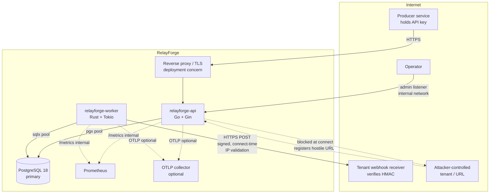
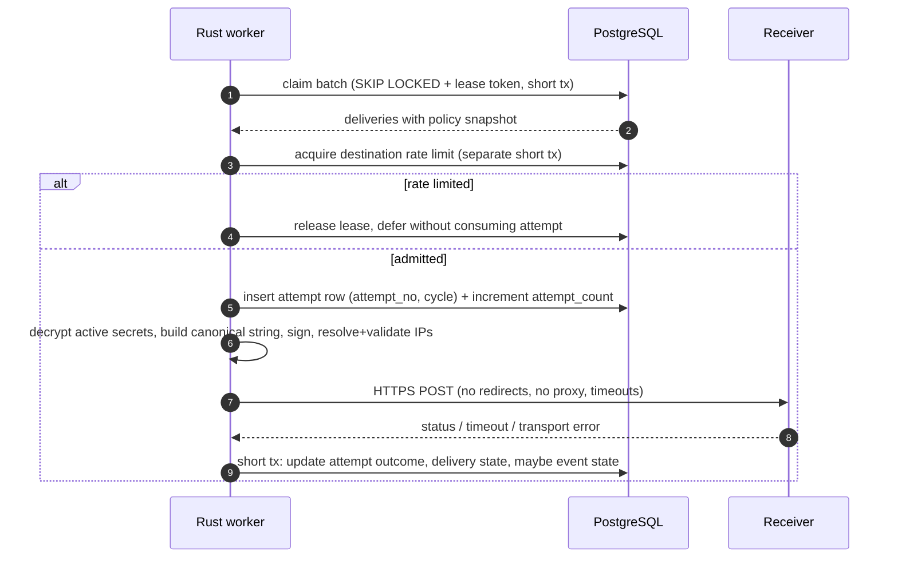

# System architecture

Status: Implemented and verified (Phases 1–7 complete). Last updated: 2026-10-23.
Both the Go control plane (`api/`) and the Rust delivery plane (`worker/`) are implemented and verified
end-to-end against PostgreSQL 18.6, including atomic ingest/fan-out, lease-fenced delivery, exponential
backoff retries, dead-lettering, connect-time SSRF protection, rate limiting, retention cleanup, and
event/admin replay. See [14-phase-3-report.md](14-phase-3-report.md) through [18-phase-7-report.md](18-phase-7-report.md).
Related: [requirements](00-requirements.md), [data model](02-data-model.md),
[delivery contract](../contracts/delivery-contract-v1.md), [ADRs](adr/).

## 1. Design constraints and the central decision

The requirements demand four things simultaneously:

1. An event and its initial delivery work must become durable atomically.
2. Concurrent workers must not process the same job.
3. Failed work must be recoverable after a crash.
4. No new infrastructure may be added without a measured reason.

Those constraints point to a single decision: **PostgreSQL is both the system of record and the durable
queue**, and the Go API writes the event and its delivery rows in one transaction. There is no “publish”
step after commit, so the classic dual-write failure disappears. The cost is that queue throughput and
bloat are bounded by PostgreSQL; that cost is documented, measured in Phase 6, and has an explicit
revisit threshold ([ADR-0002](adr/0002-postgres-as-queue.md)).

The second decision is a **modular monolith plus one separately deployable worker**. The split is
operational, not stylistic:

- Outbound delivery is long-tailed I/O against untrusted hosts. It must scale, be rate-limited, and be
  isolated from the latency of the public API.
- Delivery workers run with a different privilege profile: they need decrypt access to signing secrets
  and outbound internet, and they must not expose a public HTTP surface.
- A worker crash or memory issue must not take down ingestion.
- The Go API can then stay small: authentication, validation, transactions, and queries.

There is no claim that Rust is faster than Go here. Both perform I/O-bound work; the language choice is
mandated by the brief and justified by isolation and memory-safety for parsing untrusted HTTP responses,
not by an unmeasured speed claim ([ADR-0001](adr/0001-modular-monolith-and-worker.md)).

## 2. System context



Trust boundaries:

| Boundary | Data crossing | Control |
| --- | --- | --- |
| Internet → API | API keys, event payloads, endpoint URLs | TLS at proxy, body limits, auth, validation, rate limits |
| API → DB | All tenant data, credential digests, encrypted secrets | Parameterised SQL, least-privilege DB role, private network |
| DB → worker | Encrypted signing secrets, payloads, leases | Same private network; worker role can read delivery data |
| Worker → internet | Event payload, signature headers | SSRF connect-time policy, no redirects, no proxy, egress firewall |
| Operator → admin listener | Administrative actions | Separate listener, admin token, network restriction, audit |

## 3. Component responsibilities

### 3.1 Go control plane (`api/`)

| Module | Responsibility | Explicitly not responsible for |
| --- | --- | --- |
| `internal/config` | Parse and validate env config; fail fast on insecure defaults | Reading secrets from files committed to the repo |
| `internal/httpapi` | Router wiring, middleware, request IDs, error envelope, pagination helpers, body limits | Business rules |
| `internal/auth` | API key parsing, digest verification, tenant status, role checks | Key issuance (credentials module) |
| `internal/tenants` | Tenant lifecycle, suspension | Billing |
| `internal/credentials` | Key generation, hashing, rotation, revocation | Authentication middleware |
| `internal/endpoints` | Endpoint CRUD, URL validation, pause/resume, secret rotation orchestration | Outbound HTTP |
| `internal/secrets` | AES-256-GCM envelope encryption/decryption, KEK versions | Key distribution |
| `internal/events` | Envelope validation, schema validation, idempotency, atomic event + delivery creation | Retry decisions |
| `internal/deliveries` | Read models for delivery and attempt status | Claiming or delivering |
| `internal/replay` | Authorised, race-safe replay (cycle increment) | Delivery execution |
| `internal/audit` | Append-only audit records | Log shipping |
| `internal/ratelimit` | Tenant request limits and destination-limit primitives | Worker-side enforcement |
| `internal/ssrf` | Registration-time destination validation using the shared policy | Connect-time enforcement (worker) |
| `internal/store/postgres` | SQL, transactions, row mapping | HTTP types |
| `internal/observability` | slog JSON logging, Prometheus registry, OTel tracing | Business metrics definitions (modules own counters) |
| `internal/openapi` | Embedded OpenAPI 3.1 document and spec-serving handler | Hand-written duplicate docs |

Dependency rule: `httpx` → modules → `store` interfaces → `store/postgres`. Domain modules do not import
Gin. Handlers translate HTTP to module calls and module errors to status codes. `store/postgres` is the
only package that imports `pgx`. Interfaces are introduced per module (a repository port), not per table.

### 3.2 Rust delivery plane (`worker/`)

| Module | Responsibility |
| --- | --- |
| `config` | Env parsing, bounded values, fail-fast validation, schema-version requirement |
| `db` | sqlx pool, transaction helpers, statement/lock timeouts, readiness probe |
| `claim` | Batch claim, lease token, attempt row creation, rate-limit deferral |
| `recovery` | Expired-lease reaper, abandoned-attempt marking, retry/dead-letter decision |
| `policy` | Status classification, backoff with jitter, retry-window enforcement (single source of truth) |
| `signature` | Secret decryption, canonical string, HMAC-SHA256, header construction |
| `ssrf` | URL policy, DNS resolution, IP classification, connect-time resolver |
| `http` | reqwest client construction: TLS, no proxy, no redirects, timeouts, response cap |
| `delivery` | Per-attempt orchestration, concurrency limits, completion transaction |
| `ratelimit` | PostgreSQL destination token/fixed-window acquisition |
| `lifecycle` | Graceful shutdown, claim-loop cancellation, lease release |
| `health` | `/healthz`, `/readyz`, `/metrics` on an internal listener |

The worker never ingests events, issues credentials, or decides which endpoints exist. It reads the
policy snapshot stored on each delivery, so it does not duplicate tenant configuration rules.

### 3.3 Shared artifacts

| Artifact | Owner | Consumers | Change process |
| --- | --- | --- | --- |
| `api/migrations/*.sql` | Go control plane | Go (applies), Rust (reads only, verifies version) | Additive-first; contract review; CI up/down/up |
| `contracts/delivery-contract-v1.md` | Architecture | Go, Rust, tests | Version bump for breaking state/column changes |
| `contracts/signature-v1.md` | Security + worker | Worker, receiver, docs | Versioned signature scheme (`v1`) |
| `contracts/ssrf-policy-v1.md` + `ssrf-vectors.json` | Security | Go registration, Rust enforcement, tests | Vector changes require both suites |
| `contracts/event-envelope-v1.json` | Go | Ingest, OpenAPI, receiver docs | Additive fields only |

Migrations are owned by the control plane because the API is the only writer of schema-changing DDL.
The worker checks `schema_migrations` against a compiled-in minimum and fails readiness on mismatch. Both
services are deployed with an N/N-1 compatibility rule: additive columns only during a rolling deploy; no
destructive migration in the same release as the code that stops using the old column.

## 4. Data flow

### 4.1 Ingestion and fan-out

```mermaid
sequenceDiagram
    autonumber
    participant C as Producer
    participant A as Go API
    participant D as PostgreSQL

    C->>A: POST /api/v1/events (Idempotency-Key)
    A->>A: Authenticate key, check tenant, validate envelope and schema
    A->>D: BEGIN; upsert idempotency record
    alt key already completed with same body
        D-->>A: stored response
        A-->>C: 201 + Idempotency-Replayed: true
    else new request
        A->>D: INSERT event (uuidv7), INSERT deliveries for matching endpoints
        A->>D: UPDATE idempotency record with response; COMMIT
        A-->>C: 201 {event_id, delivery_count}
    end
```

No outbound HTTP occurs in this transaction. The event row and every initial delivery row commit
together. If there are no matching endpoints, the event commits with status `no_subscribers` and zero
deliveries; this is visible, not silently dropped.

Fan-out is bounded: at most 50 deliveries per event. Endpoint subscription changes affect future events
only; they never rewrite committed deliveries.

### 4.2 Delivery attempt



The claim transaction ends before DNS resolution or HTTP. Completion is a separate short transaction
guarded by `lease_token`. A stale worker that lost its lease updates 0 rows and must discard its result.

### 4.3 Retry and dead-letter

A transient failure moves the delivery to `retry_scheduled` with `next_attempt_at` computed by the Rust
policy module using the policy snapshot. A permanent failure moves it to `failed`. Exhausting attempts or
the retry window moves it to `dead_lettered`. Both `failed` and `dead_lettered` are replayable.

### 4.4 Replay

Replay is a conditional state transition, not a new event:

```sql
UPDATE deliveries
SET status = 'pending',
    cycle = cycle + 1,
    attempt_count = 0,
    next_attempt_at = now(),
    lease_token = NULL,
    lease_expires_at = NULL,
    completed_at = NULL,
    dead_lettered_at = NULL,
    last_error_code = NULL
WHERE id = ANY($1)
  AND tenant_id = $2
  AND status IN ('failed', 'dead_lettered')
RETURNING id, cycle;
```

`delivery_attempts` is unique on `(delivery_id, cycle, attempt_no)`, so history from earlier cycles is
preserved and cannot collide. Concurrent replays: the first transaction changes the status; the second
matches zero rows and returns `409 not_replayable`. Event status is recomputed to `delivering`.

## 5. Why PostgreSQL as the queue

| Requirement | Mechanism |
| --- | --- |
| Atomic event + work | Single transaction across `events` and `deliveries` |
| Concurrent-safe claim | `ORDER BY next_attempt_at, id FOR UPDATE SKIP LOCKED LIMIT n` |
| Crash recovery | `lease_expires_at` + reaper; stale completion guarded by `lease_token` |
| Delayed retry | `next_attempt_at` + partial index |
| Backpressure | Bounded claim batch, worker concurrency, queue-age metrics |
| No message loss on broker outage | No broker |

`SKIP LOCKED` is explicitly documented by PostgreSQL as unsuitable for general-purpose work but suitable
for queue-like tables because skipped rows give an inconsistent view. RelayForge uses it only for
claiming, never for user-facing queries. Rows locked by another claim are skipped, not waited on.

Operational costs and mitigations:

- **Bloat.** High churn on `deliveries` and `delivery_attempts`. Autovacuum is tuned per table; retention
  deletes in batches; `pg_stat_user_tables` is monitored. Partitioning by `created_at` is the scale path.
- **Lock contention.** Claim uses a partial index and a small `LIMIT`. If contention appears, add
  per-tenant or hash-bucket claim partitions, not a broker.
- **Long transactions.** Forbidden around HTTP. Statement, lock, and idle-in-transaction timeouts are set.
- **Failover duplicates.** A commit may succeed while the client sees an error; this is at-least-once.

Revisit thresholds (measured, not guessed): sustained claim contention with p95 claim latency > 50 ms,
queue depth that cannot drain within the retry window, or delivery throughput > 5,000/s on the reference
hardware. Only then evaluate a broker, and only with an outbox/dual-write design.

## 6. Transaction boundaries

| Operation | Transaction contents | Duration bound | Why |
| --- | --- | --- | --- |
| Ingest | Idempotency record, event, N deliveries, response snapshot | 5 s statement / 10 s tx | Atomic durability and idempotent replay |
| Credential create/rotate | New credential, revoke/expire old, audit | Short | No window with two usable plaintext keys unless overlap intended |
| Endpoint + secret create | Endpoint, encrypted secret, audit | Short | Endpoint must never exist without a signing secret |
| Claim | Lock due rows, set lease/token, insert attempt rows | < 100 ms typical | Must not include network I/O |
| Rate-limit acquisition | Counter upsert | < 50 ms typical | Separate from claim; denial releases the lease |
| Completion | Attempt outcome, delivery state, event projection, audit (replay only) | < 100 ms typical | Lease-guarded, idempotent on retry |
| Reaper | Expired leases, abandoned attempts, retry/dead-letter scheduling | Batched | Bounded work per tick |
| Replay | Conditional delivery reset, audit | Short | Race-safe cycle increment |
| Retention | Batched deletes | Batched | Avoid long locks and bloat |

Not allowed in any transaction: DNS resolution, outbound HTTP, large JSON schema compilation, or sleeps.

## 7. Failure-window analysis

This is the core reliability argument. “Duplicate possible” is stated wherever it is true.

| # | Failure point | What is durable | What the user sees | Recovery | Duplicate? |
| --- | --- | --- | --- | --- | --- |
| F1 | API crashes before ingest commit | Nothing | Connection error / 5xx | Client retries with same key | No |
| F2 | Commit succeeds, response lost | Event + deliveries | Client sees error | Retry with same key returns stored response | No new event |
| F3 | Client retries without idempotency key | Previous event | — | Rejected: key is required | N/A |
| F4 | Event committed, worker never claims | Event + deliveries | Pending | Queue-age alert; worker resumes | No |
| F5 | Worker claims then crashes before HTTP | Lease + attempt row | In progress until lease expires | Reaper marks attempt `abandoned`, retries; attempt consumed | No delivery yet |
| F6 | HTTP sent, receiver processed, worker crashes before completion | Lease + attempt row | In progress | Reaper retries after lease; receiver must deduplicate | **Yes** |
| F7 | Receiver processed but response lost | Same as F6 | Timeout | Retry; receiver returns 2xx for duplicate ID | **Yes** |
| F8 | Completion transaction fails (DB outage) | Lease | In progress | Worker retries completion; if it dies, lease expiry | **Yes** if HTTP succeeded |
| F9 | Reaper and worker race | Lease token | — | Completion `WHERE lease_token = $t` affects 0 rows; stale result discarded | **Yes** if worker delivered |
| F10 | Two workers claim concurrently | Locked rows | — | `SKIP LOCKED`; no shared claim | No simultaneous claim |
| F11 | Two replay requests race | Old cycle | One 202, one 409 | Conditional update | No duplicate cycle |
| F12 | Secret rotated while delivery pending | Both secrets | — | Worker reads active secrets at attempt time; receiver accepts both in overlap | No |
| F13 | Secret revoked before attempt | New active secret | Old signature only | Receiver rejects; delivery fails permanently | No, but delivery fails |
| F14 | Endpoint paused during pending delivery | Delivery row | — | In-flight attempt may complete; paused endpoint receives no new fan-out | Possibly one in-flight |
| F15 | Worker loses DB connectivity after HTTP | Lease | In progress | Lease expiry, retry | **Yes** |
| F16 | API and worker schema versions differ | Rows | Readiness fails | Deploy control plane first; worker refuses mismatched schema | No |
| F17 | Event with zero subscribers | Event | `no_subscribers` | Visible to tenant | No |

Consequences encoded in the product:

- Event IDs are stable across retries; delivery and attempt IDs are distinct and also exposed.
- Receiver verification must use the raw body and must deduplicate on `webhook-id` durably.
- `delivery_attempts` is append-only; an abandoned attempt is a factual record, not an error to hide.
- Replay is explicit, authorised, and audited because it intentionally creates more attempts.

## 8. Duplicate-delivery windows (explicit statement)

RelayForge guarantees **at least one** delivery attempt per (event, endpoint) unless the endpoint is
disabled before fan-out or the tenant is suspended. It never guarantees that a receiver sees an event
only once. The windows are F6–F9, plus operator-initiated replay. The engine does not attempt to
“deduplicate” at the network layer, because that would require receiver cooperation it cannot verify.
Instead it makes duplicates identifiable (`webhook-id` stable, `RelayForge-Delivery` stable, fresh
`webhook-timestamp`) and documents the receiver obligation.

## 9. Go ↔ Rust boundary

| Concern | Decided by | Executed by |
| --- | --- | --- |
| Which endpoints receive an event | Go (subscription query at ingest) | — |
| Delivery policy values | Go snapshots them onto the delivery row at ingest | Rust applies them |
| Which status codes are retryable | Rust `policy` module (single source of truth) | Rust |
| Backoff computation | Rust `policy` module | Rust |
| Claim safety | Contract SQL | Rust |
| Signature canonicalisation | `contracts/signature-v1.md` | Rust |
| Secret encryption | Go `secrets` module | Rust decrypts |
| Event status projection | Contract rule | Rust on terminal delivery transitions |
| Replay eligibility | Go | Rust delivers the reset delivery |

Go must not reimplement retry classification “for display”. The delivery API exposes the stored
`last_error_code` and policy snapshot; it does not compute a next retry time in Go except for reads of
`next_attempt_at` already written by the worker.

## 10. Configuration and secure defaults

All configuration is environment-based and validated at startup. No secret has a default. The process
exits non-zero on invalid or missing required configuration.

Implemented in Phase 1:

| Variable | Default | Notes |
| --- | --- | --- |
| `RELAYFORGE_DATABASE_URL` | required | `postgres://` or `postgresql://`; `sslmode` must be `require`, `verify-ca`, or `verify-full` in staging/production |
| `RELAYFORGE_ENV` | `development` | `development`, `test`, `staging`, or `production` |
| `RELAYFORGE_HTTP_ADDR` | `:8080` | Public API listener |
| `RELAYFORGE_ADMIN_ADDR` | `:9090` | Health and metrics; bind to loopback or a private interface |
| `RELAYFORGE_ADMIN_TOKEN` | unset | Required in production; sent as `X-Admin-Token` for `/metrics` |
| `RELAYFORGE_LOG_LEVEL` | `info` | `debug`, `info`, `warn`, `error` |
| `RELAYFORGE_EXPECTED_SCHEMA_VERSION` | `5` | Readiness fails on mismatch or dirty migration |
| `RELAYFORGE_DB_MAX_CONNS` | `10` | Bounded pool |
| `RELAYFORGE_SHUTDOWN_TIMEOUT` | `15s` | Graceful shutdown budget |
| `RELAYFORGE_READINESS_TIMEOUT` | `2s` | Per readiness check |
| `RELAYFORGE_MIGRATIONS_DIR` | `migrations` | Migration source directory |
| `RELAYFORGE_OTEL_ENDPOINT` | unset | OTLP/HTTP trace endpoint; tracing disabled when unset |
| `RELAYFORGE_WORKER_ID` | `worker-<8 hex>` | Diagnostic identity, ≤ 100 chars |
| `RELAYFORGE_WORKER_HEALTH_ADDR` | `0.0.0.0:9090` | Worker health and metrics listener |
| `RELAYFORGE_WORKER_CONCURRENCY` | `8` | Bounded 1–256 |
| `RELAYFORGE_WORKER_POLL_INTERVAL_MS` | `1000` | Readiness loop; ≥ 100 ms |
| `RELAYFORGE_SHUTDOWN_TIMEOUT_SECONDS` | `15` | Worker graceful shutdown budget |

Planned but **not implemented** until later phases: `RELAYFORGE_API_KEY_PEPPER`, `RELAYFORGE_KEK` and
`RELAYFORGE_KEK_VERSION`, signup mode/token, event and fan-out limits, idempotency TTL, retention, and the
worker lease/claim settings. Do not assume those variables are read by the Phase 1 binaries.

Operational rules:

- The internal listener is bound to a private interface in production. Metrics and admin endpoints are
  never exposed through the public reverse proxy.
- In production, `RELAYFORGE_ADMIN_TOKEN` is mandatory; an empty token is accepted only outside production
  so local scraping works without a secret. The token check is constant-time.
- `sslmode` is validated: `disable` is accepted only outside staging/production.
- This Phase 1 process does **not** yet require a KEK or API-key pepper because it does not create or
  decrypt secrets. Phase 2 must add them before key or endpoint-secret features ship.
- Proxy environment variables are ignored by the delivery client by construction, not by convention.

## 11. Observability

Logs: JSON via `slog` (Go) and `tracing` (Rust), one line per request/attempt/state transition. Common
fields: `service`, `version`, `request_id`, `trace_id`, `tenant_id`, `event_id`, `delivery_id`,
`attempt_no`, `outcome`, `error_code`. Never logged: API keys, signing secrets, `Authorization`,
`webhook-signature`, full payloads, full response bodies. Payload hash and byte count are logged instead.

Metrics (names are contracts; no tenant label to bound cardinality):

| Metric | Type | Labels |
| --- | --- | --- |
| `relayforge_http_requests_total` | counter | route, method, status |
| `relayforge_http_request_duration_seconds` | histogram | route, method |
| `relayforge_events_ingested_total` | counter | event_type (bounded allowlist? no: use `other`) |
| `relayforge_deliveries_total` | counter | outcome |
| `relayforge_delivery_attempts_total` | counter | outcome, error_code |
| `relayforge_delivery_duration_seconds` | histogram | outcome |
| `relayforge_queue_due` | gauge | — |
| `relayforge_queue_oldest_age_seconds` | gauge | — |
| `relayforge_lease_recoveries_total` | counter | — |
| `relayforge_rate_limit_denied_total` | counter | scope |
| `relayforge_ssrf_blocks_total` | counter | reason |
| `relayforge_db_pool_acquired` / `_max` | gauge | — |

Tracing: W3C `traceparent` is accepted at ingest and persisted on the event; the worker creates a span
with that remote parent for the first attempt of each delivery. Retries link to the original trace, not
a new root. OTLP/HTTP export is optional; the system must work with tracing disabled.

Health semantics:

- `GET /healthz` (liveness): process is running and the HTTP listener responds. No DB dependency.
- `GET /readyz` (readiness): DB ping within 2 s, schema version matches, config loaded, worker claim loop
  running and not shutting down. Failing readiness removes the instance from rotation but does not kill it.

## 12. Deployment topology

Local/reference Compose services:

| Service | Image | Networks | Exposed |
| --- | --- | --- | --- |
| `postgres` | `postgres:18.6-alpine` | `data` (internal) | No host port by default |
| `api` | built Go image, non-root | `edge`, `data` | `8080` (public), `9090` internal |
| `worker` | built Rust image, non-root | `data`, `egress` | `9090` internal only |
| `receiver` | built Go demo image | `edge` | `8090` for E2E |
| `prometheus` | pinned image | `data`/monitoring | `9090` local only (profile `observability`) |

Production expectations, stated as requirements rather than claims:

- TLS 1.2+ terminated at a reverse proxy; HSTS at the proxy; request body cap also enforced there.
- PostgreSQL with automated backups, PITR, and a tested restore procedure.
- Worker egress restricted by network policy/security group to the public internet, with no route to the
  database subnet other than PostgreSQL, and no cloud metadata route. Compose cannot prove this; a
  production deployment must enforce it outside the application.
- Separate DB roles: `relayforge_api` (read/write control-plane tables), `relayforge_worker`
  (read events/secrets, write delivery state), `relayforge_readonly` for operations.
- Secrets injected from a secret manager; the KEK is never in an image or a Compose file committed to git.

## 13. Capacity model (planning, not measurement)

At 10 events/s, 2 endpoints, 30-day retention, 2 KiB mean payload:

| Table | Rows/day | Rows at 30 d | Notes |
| --- | --- | --- | --- |
| events | 864,000 | 25.9 M | ~2 KiB payload + indexes; plan ~70–100 GB |
| deliveries | 1.73 M | 51.8 M | ~300 B/row + indexes |
| delivery_attempts | ~1.9 M | ~57 M | 20% retry assumption |
| audit_logs | low thousands | ~1 M | 1-year retention |

These are estimates to size a benchmark database, not guarantees. Phase 6 replaces them with measured
row sizes, index sizes, and vacuum behaviour. If the estimate is materially wrong, retention and
partitioning decisions change before any performance claim is made.

## 14. Architectural risks

| Risk | Impact | Mitigation / decision point |
| --- | --- | --- |
| PostgreSQL queue contention at scale | Delivery latency, backlog | Measure claim p95; partition or shard claims; broker only with evidence |
| Table bloat from churn | Query slowdown, disk growth | Per-table autovacuum, batched retention, monitoring, partitioning path |
| Shared KEK across services | Wider secret blast radius | Least-privilege deployment, KMS/signing service as future ADR |
| SSRF policy bypass | Internal network access | Connect-time resolver, deny list, no redirects/proxy, egress policy, regression vectors |
| Duplicate deliveries | Business side effects | Required receiver idempotency, stable IDs, documented windows, demo receiver |
| Rust/Go contract drift | Wrong state transitions | One versioned contract, SQLx compile checks, shared conformance vectors |
| JSON Schema validation cost | Ingest latency | Bounded schema size, compiled-schema cache, benchmark before enabling by default |
| Windows dev / Linux CI divergence | “Works on my machine” | Docker-based tests, `.gitattributes`, CI as authority |
| Self-service signup abuse | Resource exhaustion | Rate limit, optional signup token, per-tenant caps |

## 15. What is deliberately not built

- No service mesh, no sidecar, no message broker, no cache layer, no CQRS split.
- No generic repository abstraction over multiple databases.
- No domain event bus inside the monolith; module calls are explicit.
- No background job framework in Go; cleanup is a single bounded loop with advisory locking.
- No custom crypto. AES-GCM, HMAC-SHA256, and OS CSPRNG only.

Each omission is a decision to keep the failure surface explainable, not a claim that the omitted
component is unnecessary at all scales.
