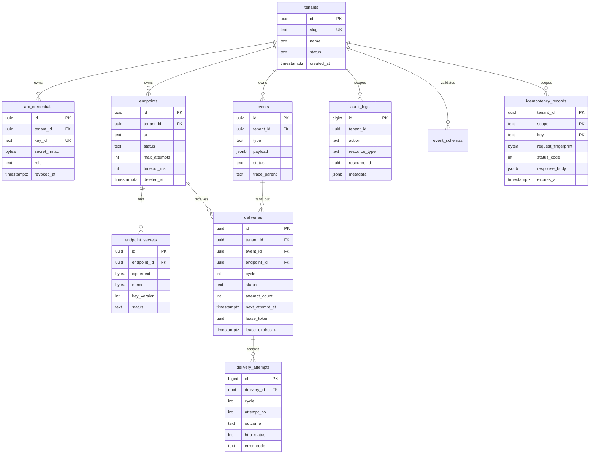

# Data model and database design

Status: implemented through Phase 7; schema version remains 5. Last updated: 2026-10-24.
This document is the schema contract for both services. Migrations `0001`–`0005` implement this target;
any divergence between this document and the migrations is a defect. Phase 2 added no migration.

## 1. Principles

1. **Tenant ownership is a column, not an inference.** Every tenant-owned table has `tenant_id`, and every
   query filters on it. Cross-tenant access returns `404`, never `403`, to avoid existence leaks.
2. **Explicit states.** Statuses are `text` with `CHECK` constraints, not PostgreSQL enums. Adding a value
   is a constraint change that can be rolled out without `ALTER TYPE` locking surprises; the allowed set is
   still enforced by the database.
3. **Time is `timestamptz`, always UTC.** No `timestamp without time zone` anywhere.
4. **IDs are UUIDv7 generated by PostgreSQL 18's `uuidv7()`** for time-ordered inserts. Event IDs are
   exposed and stable. Attempt IDs are `bigint` because they are internal and append-only.
5. **JSONB only where the shape is genuinely tenant-defined** (payload, schema, audit metadata). JSONB is
   not used for columns that are filtered or joined.
6. **Indexes exist for named queries.** Every index below names the access path it serves. No speculative
   indexes.
7. **Attempts are append-only.** No update deletes an attempt; outcomes are written once.
8. **No hard delete of tenants.** Endpoints are soft-deleted. Events and attempts are removed only by a
   retention job, which is itself an explicit policy.

## 2. ERD



## 3. Table definitions

### 3.1 `tenants`

| Column | Type | Constraints | Notes |
| --- | --- | --- | --- |
| `id` | `uuid` | PK, default `uuidv7()` | Never reused |
| `slug` | `text` | `NOT NULL`, `UNIQUE`, `CHECK (slug ~ '^[a-z0-9][a-z0-9-]{2,62}$')` | Display and support identifier |
| `name` | `text` | `NOT NULL`, `CHECK (length BETWEEN 1 AND 200)` | Untrusted input; encoded on output |
| `status` | `text` | `NOT NULL DEFAULT 'active'`, `CHECK IN ('active','suspended')` | Suspension blocks auth |
| `created_at` | `timestamptz` | `NOT NULL DEFAULT now()` | |
| `updated_at` | `timestamptz` | `NOT NULL DEFAULT now()` | Trigger-free: updated explicitly |
| `suspended_at` | `timestamptz` | NULL | Set with status |

Index: `tenants_slug_key` (unique) serves lookup by slug and duplicate detection. No index on `status`;
tenant counts are small and suspension is not a hot path.

Retention: no deletion in v1. Tenant deletion is an operator procedure that must be designed later
(GDPR erasure is a known limitation).

### 3.2 `api_credentials`

| Column | Type | Constraints | Notes |
| --- | --- | --- | --- |
| `id` | `uuid` | PK, default `uuidv7()` | |
| `tenant_id` | `uuid` | `NOT NULL REFERENCES tenants(id) ON DELETE RESTRICT` | |
| `name` | `text` | `NOT NULL`, length 1–100 | Operator label |
| `key_id` | `text` | `NOT NULL`, `UNIQUE`, `CHECK (key_id ~ '^[a-z0-9]{12}$')` | Non-secret lookup handle |
| `secret_hmac` | `bytea` | `NOT NULL`, `CHECK (octet_length = 32)` | HMAC-SHA256(pepper, secret) |
| `role` | `text` | `NOT NULL`, `CHECK IN ('owner','admin','ingest','viewer')` | Authorisation |
| `created_at` | `timestamptz` | `NOT NULL DEFAULT now()` | |
| `last_used_at` | `timestamptz` | NULL | Async best-effort update, not per-request blocking |
| `expires_at` | `timestamptz` | NULL | Optional hard expiry |
| `revoked_at` | `timestamptz` | NULL | Revocation is terminal |
| `rotated_from` | `uuid` | NULL, `REFERENCES api_credentials(id)` | Lineage |

Indexes:
- `api_credentials_key_id_key` (unique): authentication lookup by public key ID.
- `api_credentials_tenant_id_created_at_idx` `(tenant_id, created_at DESC)`: list credentials.

Plaintext key format: `rf_<env>_<key_id>_<secret>` where `secret` is 32 random bytes encoded with
unpadded base32 (52 chars). The `key_id` is 12 random base32 chars. Only the digest and key ID are stored.
`last_used_at` is updated at most once per 60 s per key, asynchronously, to avoid a write per request.

### 3.3 `endpoints`

| Column | Type | Constraints | Notes |
| --- | --- | --- | --- |
| `id` | `uuid` | PK, default `uuidv7()` | |
| `tenant_id` | `uuid` | `NOT NULL REFERENCES tenants(id) ON DELETE RESTRICT` | |
| `name` | `text` | `NOT NULL`, length 1–100 | |
| `url` | `text` | `NOT NULL`, length ≤ 2048, `CHECK (url ~ '^https://')` | Authoritative validation in app |
| `status` | `text` | `NOT NULL DEFAULT 'active'`, `CHECK IN ('active','paused','disabled')` | `disabled` is system auto-pause |
| `event_types` | `text[]` | `NOT NULL DEFAULT '{}'` | Empty = all types; max 20 entries |
| `max_attempts` | `int` | `NOT NULL DEFAULT 8`, `CHECK BETWEEN 1 AND 20` | Policy snapshot source |
| `initial_backoff_ms` | `int` | `NOT NULL DEFAULT 5000`, `CHECK BETWEEN 100 AND 3600000` | |
| `max_backoff_ms` | `int` | `NOT NULL DEFAULT 3600000`, `CHECK >= initial_backoff_ms` | |
| `retry_window_seconds` | `int` | `NOT NULL DEFAULT 86400`, `CHECK BETWEEN 60 AND 604800` | |
| `timeout_ms` | `int` | `NOT NULL DEFAULT 15000`, `CHECK BETWEEN 1000 AND 30000` | Total attempt timeout |
| `rate_limit_per_sec` | `int` | `NOT NULL DEFAULT 10`, `CHECK BETWEEN 1 AND 100` | Destination limit |
| `consecutive_failures` | `int` | `NOT NULL DEFAULT 0`, `CHECK >= 0` | Reset on success |
| `disabled_at` | `timestamptz` | NULL | |
| `disabled_reason` | `text` | NULL | Machine-readable reason |
| `created_at` / `updated_at` | `timestamptz` | `NOT NULL DEFAULT now()` | |
| `deleted_at` | `timestamptz` | NULL | Soft delete |

Indexes:
- `endpoints_tenant_url_active_key` unique on `(tenant_id, lower(url)) WHERE deleted_at IS NULL`:
  prevent duplicate active subscriptions for the same URL.
- `endpoints_tenant_created_idx` `(tenant_id, created_at DESC) WHERE deleted_at IS NULL`: list.
- `endpoints_fanout_idx` `(tenant_id) INCLUDE (id, event_types, max_attempts, initial_backoff_ms,
  max_backoff_ms, retry_window_seconds, timeout_ms, rate_limit_per_sec) WHERE status = 'active' AND
  deleted_at IS NULL`: fan-out scan. Consider GIN on `event_types` only if tenant endpoint counts grow
  large; with a 50-endpoint cap, a per-tenant scan is cheaper and simpler.

### 3.4 `endpoint_secrets`

| Column | Type | Constraints | Notes |
| --- | --- | --- | --- |
| `id` | `uuid` | PK, default `uuidv7()` | |
| `tenant_id` | `uuid` | `NOT NULL REFERENCES tenants(id) ON DELETE RESTRICT` | Denormalised for scoped queries |
| `endpoint_id` | `uuid` | `NOT NULL REFERENCES endpoints(id) ON DELETE CASCADE` | |
| `ciphertext` | `bytea` | `NOT NULL` | AES-256-GCM output including tag |
| `nonce` | `bytea` | `NOT NULL`, `CHECK (octet_length = 12)` | 96-bit random nonce, unique per encryption |
| `key_version` | `int` | `NOT NULL` | KEK rotation |
| `secret_hint` | `text` | `NOT NULL` | Last 4 characters, for UI only |
| `status` | `text` | `NOT NULL DEFAULT 'active'`, `CHECK IN ('active','retired')` | |
| `created_at` | `timestamptz` | `NOT NULL DEFAULT now()` | |
| `expires_at` | `timestamptz` | NULL | Overlap deadline |
| `retired_at` | `timestamptz` | NULL | |

Indexes:
- `endpoint_secrets_active_idx` `(endpoint_id) WHERE status = 'active'`: worker fetch at attempt time.
- `endpoint_secrets_tenant_idx` `(tenant_id, endpoint_id)`: scoped metadata listing.

AAD binds `tenant_id || endpoint_id || secret_id || key_version` so ciphertext cannot be transplanted
between rows or tenants without detection.

Maximum two active secrets per endpoint, enforced in the rotation transaction (`SELECT ... FOR UPDATE` on
the endpoint, count active, reject at 2). This is a business rule with a database backstop if feasible via
a partial unique index on `(endpoint_id, status)`? That would allow only one active row, which conflicts
with overlap. A trigger is possible but adds hidden logic; the transaction check is documented and tested.

### 3.5 `events`

| Column | Type | Constraints | Notes |
| --- | --- | --- | --- |
| `id` | `uuid` | PK, default `uuidv7()` | Public, stable event ID (`webhook-id`) |
| `tenant_id` | `uuid` | `NOT NULL REFERENCES tenants(id) ON DELETE RESTRICT` | |
| `type` | `text` | `NOT NULL`, `CHECK (type ~ '^[a-z][a-z0-9_]*(\.[a-z0-9_]+){1,3}$')`, length ≤ 100 | Event type |
| `schema_version` | `int` | `NOT NULL DEFAULT 1`, `CHECK > 0` | Envelope schema, not payload schema |
| `occurred_at` | `timestamptz` | `NOT NULL` | Client-supplied, bounded |
| `received_at` | `timestamptz` | `NOT NULL DEFAULT now()` | Server time |
| `wire_body` | `bytea` | `NOT NULL`, `CHECK (octet_length BETWEEN 1 AND 262144)` | Exact minified bytes accepted at ingest; signed and delivered unchanged |
| `content_type` | `text` | `NOT NULL DEFAULT 'application/json'` | Constrained to `application/json` in v1 |
| `payload` | `jsonb` | `NOT NULL`, `CHECK (jsonb_typeof(payload) = 'object')` | Parsed `data` object for inspection |
| `payload_bytes` | `int` | `NOT NULL`, `CHECK BETWEEN 1 AND 262144` | Measured after decode |
| `payload_sha256` | `bytea` | `NOT NULL`, `CHECK (octet_length = 32)` | Logging/correlation without body |
| `trace_parent` | `text` | NULL, length ≤ 128 | W3C trace context |
| `status` | `text` | `NOT NULL DEFAULT 'accepted'`, `CHECK IN ('accepted','delivering','delivered','partially_delivered','failed','no_subscribers')` | Derived projection, see contract |
| `delivery_count` | `int` | `NOT NULL DEFAULT 0`, `CHECK BETWEEN 0 AND 50` | Snapshot of fan-out size |
| `created_at` / `updated_at` | `timestamptz` | `NOT NULL DEFAULT now()` | |

Why store both `wire_body` and `payload`: deliveries must sign a byte-stable body across retries and
replays. Re-serialising JSONB is not guaranteed to produce identical bytes (key order, whitespace, number
formatting), and a signature over re-serialised JSON is a classic production failure. The worker sends
`wire_body` unchanged; retries and replays reuse those exact bytes, changing only the timestamp and
signature. `payload` is a parsed copy for inspection and filtering. The duplication is bounded by the
256 KiB cap and is justified by signature stability.

Indexes:
- `events_tenant_created_idx` `(tenant_id, created_at DESC, id DESC)`: cursor list.
- `events_tenant_type_created_idx` `(tenant_id, type, created_at DESC, id DESC)`: filtered list.
- `events_tenant_status_created_idx` `(tenant_id, status, created_at DESC, id DESC)`: operator filters.
- No GIN index on `payload`. Payload content is not a supported filter; adding one would invite unbounded
  queries and index bloat.
- `events_retention_idx` `(created_at)`: batched retention deletes.

### 3.6 `deliveries`

Named `deliveries`, not `delivery_jobs`, because one row represents the whole delivery lifecycle for an
(event, endpoint) pair, including retries and replay cycles. A “job” is one claim; conflating the two
would either lose history or force a new row per attempt. The brief permits justified schema changes.

| Column | Type | Constraints | Notes |
| --- | --- | --- | --- |
| `id` | `uuid` | PK, default `uuidv7()` | `RelayForge-Delivery` header |
| `tenant_id` | `uuid` | `NOT NULL REFERENCES tenants(id) ON DELETE RESTRICT` | |
| `event_id` | `uuid` | `NOT NULL REFERENCES events(id) ON DELETE CASCADE` | |
| `endpoint_id` | `uuid` | `NOT NULL REFERENCES endpoints(id) ON DELETE RESTRICT` | Preserve history if endpoint deleted |
| `cycle` | `int` | `NOT NULL DEFAULT 1`, `CHECK >= 1` | Replay generation |
| `cycle_started_at` | `timestamptz` | `NOT NULL DEFAULT now()` | Retry-window anchor; reset on replay |
| `status` | `text` | `NOT NULL DEFAULT 'pending'`, `CHECK IN ('pending','in_progress','retry_scheduled','delivered','failed','dead_lettered','canceled')` | |
| `attempt_count` | `int` | `NOT NULL DEFAULT 0`, `CHECK >= 0` | Consumed attempts; incremented at claim, decremented on rate-limit deferral |
| `attempt_seq` | `int` | `NOT NULL DEFAULT 0`, `CHECK (attempt_seq >= attempt_count)` | Monotonic claim counter; never decremented; scopes attempt history |
| `max_attempts` | `int` | `NOT NULL` | Policy snapshot |
| `initial_backoff_ms` | `int` | `NOT NULL` | Policy snapshot |
| `max_backoff_ms` | `int` | `NOT NULL` | Policy snapshot |
| `retry_window_seconds` | `int` | `NOT NULL` | Policy snapshot |
| `timeout_ms` | `int` | `NOT NULL` | Policy snapshot |
| `next_attempt_at` | `timestamptz` | `NOT NULL DEFAULT now()` | Claim ordering |
| `lease_token` | `uuid` | NULL | Per-attempt fencing token |
| `lease_expires_at` | `timestamptz` | NULL | Crash recovery |
| `worker_id` | `text` | NULL, length ≤ 100 | Diagnostics |
| `last_error_code` | `text` | NULL, length ≤ 64 | Stable enum-like code |
| `last_error_detail` | `text` | NULL, length ≤ 512 | Redacted, truncated |
| `last_http_status` | `int` | NULL, `CHECK BETWEEN 100 AND 599` | |
| `created_at` / `updated_at` | `timestamptz` | `NOT NULL DEFAULT now()` | |
| `completed_at` | `timestamptz` | NULL | Terminal timestamp |
| `dead_lettered_at` | `timestamptz` | NULL | |

Constraints:
- `UNIQUE (event_id, endpoint_id)`: exactly one delivery per pair across all cycles.
- `CHECK (status <> 'in_progress' OR (lease_token IS NOT NULL AND lease_expires_at IS NOT NULL))`:
  an in-progress row cannot exist without a lease.
- `CHECK (attempt_count <= max_attempts)`: a delivery cannot exceed its snapshot policy.
- `CHECK (attempt_seq >= attempt_count)`: rate-limit deferrals consume a sequence number but not an attempt.
- `CHECK (lease_expires_at IS NULL OR lease_expires_at > created_at)`: sanity, not a timing guarantee.
- `completed_at` is set iff status is terminal. Enforced in application SQL and checked by a test; a
  table `CHECK` cannot express it without volatile behaviour. Documented invariant.

Indexes:
- `deliveries_claim_idx` `(next_attempt_at, id) WHERE status IN ('pending','retry_scheduled')`:
  the claim query. Partial index keeps it small even as history grows.
- `deliveries_lease_idx` `(lease_expires_at) WHERE status = 'in_progress'`: reaper scan.
- `deliveries_tenant_created_idx` `(tenant_id, created_at DESC, id DESC)`: list.
- `deliveries_tenant_status_created_idx` `(tenant_id, status, created_at DESC, id DESC)`: filtered list.
- `deliveries_event_idx` `(event_id)`: event detail and status projection.
- `deliveries_endpoint_status_idx` `(endpoint_id, status) WHERE status IN ('pending','retry_scheduled','in_progress')`:
  endpoint backlog and pause/disable checks.
- `deliveries_retention_idx` `(created_at)`: retention.

### 3.7 `delivery_attempts`

| Column | Type | Constraints | Notes |
| --- | --- | --- | --- |
| `id` | `bigint` | PK, `GENERATED ALWAYS AS IDENTITY` | Append-only |
| `tenant_id` | `uuid` | `NOT NULL REFERENCES tenants(id) ON DELETE RESTRICT` | Scoped queries |
| `delivery_id` | `uuid` | `NOT NULL REFERENCES deliveries(id) ON DELETE CASCADE` | |
| `cycle` | `int` | `NOT NULL`, `CHECK >= 1` | Replay cycle |
| `attempt_no` | `int` | `NOT NULL`, `CHECK >= 1` | Monotonic `attempt_seq` within a cycle |
| `started_at` | `timestamptz` | `NOT NULL DEFAULT now()` | Set at claim |
| `finished_at` | `timestamptz` | NULL | NULL while running |
| `outcome` | `text` | NULL, `CHECK IN ('success','retryable_failure','permanent_failure','timeout','blocked','rate_limited','abandoned','canceled')` | |
| `http_status` | `int` | NULL, `CHECK BETWEEN 100 AND 599` | |
| `error_code` | `text` | NULL, length ≤ 64 | |
| `error_detail` | `text` | NULL, length ≤ 512 | Redacted |
| `duration_ms` | `int` | NULL, `CHECK >= 0` | Wall clock of the HTTP stage |
| `worker_id` | `text` | NULL | |

Constraints and indexes:
- `UNIQUE (delivery_id, cycle, attempt_no)`: exactly one attempt row per sequence number; prevents double claim
  from inserting twice.
- `CHECK (attempt_no >= 1)` and `CHECK (attempt_no <= 1000)`: hard sanity bound independent of policy.
- `delivery_attempts_delivery_idx` `(delivery_id, started_at DESC)`: history endpoint.
- `delivery_attempts_tenant_started_idx` `(tenant_id, started_at DESC)`: operator queries.
- `delivery_attempts_retention_idx` `(started_at)`: retention.
- `CHECK (finished_at IS NULL OR finished_at >= started_at)`.

An attempt row is inserted in the claim transaction with `finished_at = NULL`. Completion updates it by
`(delivery_id, cycle, attempt_no)` only if the delivery still holds the same `lease_token`. If the lease
was lost, the update affects 0 rows and the worker discards the result; the reaper marks the attempt
`abandoned`.

### 3.8 `event_schemas`

| Column | Type | Constraints |
| --- | --- | --- |
| `id` | `uuid` | PK, default `uuidv7()` |
| `tenant_id` | `uuid` | `NOT NULL REFERENCES tenants(id) ON DELETE CASCADE` |
| `event_type` | `text` | `NOT NULL`, same regex as events |
| `version` | `int` | `NOT NULL`, `CHECK > 0` |
| `schema` | `jsonb` | `NOT NULL`, ≤ 64 KiB |
| `created_at` | `timestamptz` | `NOT NULL DEFAULT now()` |

`UNIQUE (tenant_id, event_type, version)`. Index `(tenant_id, event_type, version DESC)` serves
“latest schema for type”. Compiled schemas are cached in memory with a bounded LRU and an explicit
invalidation on write; a stale cache is a correctness bug, so writes bump a version and the cache key
includes it.

### 3.9 `idempotency_records`

| Column | Type | Constraints | Notes |
| --- | --- | --- | --- |
| `tenant_id` | `uuid` | `NOT NULL REFERENCES tenants(id) ON DELETE CASCADE` | |
| `scope` | `text` | `NOT NULL`, length ≤ 64 | e.g. `events.create` |
| `key` | `text` | `NOT NULL`, length 8–255, `CHECK (key ~ '^[A-Za-z0-9_.:-]+$')` | Client-supplied |
| `request_fingerprint` | `bytea` | `NOT NULL`, length 32 | SHA-256 of raw body |
| `status_code` | `int` | `NOT NULL` | Stored response |
| `response_body` | `jsonb` | `NOT NULL` | ≤ 64 KiB by construction |
| `created_at` | `timestamptz` | `NOT NULL DEFAULT now()` | |
| `expires_at` | `timestamptz` | `NOT NULL` | `created_at + TTL` |

Primary key `(tenant_id, scope, key)`. Index `(expires_at)` for cleanup. A completed row is returned on
replay with `Idempotency-Replayed: true`. There is no `in_progress` state visible to other transactions:
the ingest transaction either commits the record with its response or rolls back both, so a concurrent
request blocks on the unique index until the first commits, then sees the completed row. `lock_timeout`
bounds that wait; on timeout the API returns `409 idempotency_in_progress`.

### 3.10 `audit_logs`

| Column | Type | Constraints | Notes |
| --- | --- | --- | --- |
| `id` | `bigint` | PK, identity | Append-only |
| `tenant_id` | `uuid` | NULL, `REFERENCES tenants(id) ON DELETE RESTRICT` | NULL for platform actions |
| `actor_type` | `text` | `NOT NULL`, `CHECK IN ('api_key','admin_token','system')` | |
| `actor_id` | `text` | `NOT NULL` | Credential ID, `admin`, or worker ID |
| `action` | `text` | `NOT NULL`, length ≤ 64 | e.g. `endpoint.secret.rotate` |
| `resource_type` | `text` | `NOT NULL`, length ≤ 32 | |
| `resource_id` | `uuid` | NULL | |
| `request_id` | `text` | NULL | Correlation |
| `ip` | `inet` | NULL | Trusted proxy only; not trusted for authz |
| `user_agent` | `text` | NULL, length ≤ 512 | Truncated, untrusted |
| `metadata` | `jsonb` | `NOT NULL DEFAULT '{}'` | Explicitly redacted |
| `created_at` | `timestamptz` | `NOT NULL DEFAULT now()` | |

Indexes: `(tenant_id, created_at DESC, id DESC)`, `(resource_type, resource_id, created_at DESC)`,
`(created_at)` for retention. No update/delete methods exist in the application. The DB role for the API
is granted `INSERT` and `SELECT` only on this table.

### 3.11 `rate_limit_counters`

| Column | Type | Constraints |
| --- | --- | --- |
| `scope_type` | `text` | `NOT NULL`, `CHECK IN ('tenant_ingest','tenant_management','destination')` |
| `scope_id` | `uuid` | `NOT NULL` |
| `window_start` | `timestamptz` | `NOT NULL` |
| `count` | `int` | `NOT NULL`, `CHECK >= 0` |

Primary key `(scope_type, scope_id, window_start)`. Index `(window_start)` for cleanup. Fixed-window
counters are intentionally simple: one atomic upsert per request/delivery, no long transaction. The
trade-off is a burst at window boundaries, documented in [ADR-0011](adr/0011-postgres-rate-limiter.md).
A sliding-window or Redis implementation is a measured optimization, not a default.

### 3.12 `schema_migrations`

Managed by `golang-migrate`. The worker reads the current version and dirty flag; it never writes.

## 4. Named access paths and expected plans

Plans below are expectations, not results. Phase 2 captured `EXPLAIN (ANALYZE, BUFFERS)` for tenant event,
delivery, audit, event-type, and claim queries on a disposable 50,000-row fixture; the selected indexes are
recorded in [13-phase-2-report.md](13-phase-2-report.md). Remaining paths are rechecked in Phase 6. Any plan
that degrades to a sequential scan on a large table is a defect.

| Query | Index | Expected plan |
| --- | --- | --- |
| Claim due deliveries | `deliveries_claim_idx` | Index scan, `Limit`, `LockRows`, no sort |
| Reap expired leases | `deliveries_lease_idx` | Index scan, bounded batch |
| List tenant events | `events_tenant_created_idx` | Index scan backward, cursor predicate |
| List events by type | `events_tenant_type_created_idx` | Index scan backward |
| Event detail + deliveries | `deliveries_event_idx` | Index scan, nested loop |
| Delivery history | `delivery_attempts_delivery_idx` | Index scan backward |
| Auth lookup | `api_credentials_key_id_key` | Unique index scan |
| Active secrets for delivery | `endpoint_secrets_active_idx` | Index scan, ≤ 2 rows |
| Fan-out endpoint lookup | `endpoints_fanout_idx` | Index-only scan, ≤ 50 rows |
| Idempotency replay | primary key | Unique index scan |
| Retention delete | `*_retention_idx` | Batched index scan + delete |

Cursor pagination uses keyset predicates, not `OFFSET`:

```sql
WHERE tenant_id = $1
  AND (created_at, id) < ($2, $3)
ORDER BY created_at DESC, id DESC
LIMIT $4;
```

## 5. Migration plan

| Migration | Contents | Reversible? |
| --- | --- | --- |
| `0001_extensions_and_tenants` | `pgcrypto` (or rely on native `uuidv7`), `tenants`, updated-at helper if used | Yes |
| `0002_credentials_and_audit` | `api_credentials`, `audit_logs` | Yes |
| `0003_endpoints_and_secrets` | `endpoints`, `endpoint_secrets` | Yes |
| `0004_events_and_deliveries` | `events`, `deliveries`, `delivery_attempts`, `event_schemas`, `idempotency_records` | Yes |
| `0005_rate_limits_and_indexes` | `rate_limit_counters`, remaining indexes, constraint checks | Yes |
| `0006_seed_dev_tenant` | Dev-only seed behind an explicit command, not a migration | N/A |

Rules:
- Every migration is forward-only in production; `down` exists for tests and local recovery.
- No `CONCURRENTLY` inside a transaction-bound migration. Large index creation is a separate documented
  operation if it becomes necessary; at initial data volume, normal creation is acceptable.
- Additive-first rollout. Destructive changes require a two-release sequence.
- CI runs `up`, `down` (to zero), `up` again against an empty PostgreSQL 18.6 database.
- `schema_migrations` dirty state fails readiness and is a page-worthy alert.

## 6. Retention and cleanup

| Data | Default retention | Mechanism |
| --- | --- | --- |
| `idempotency_records` | 24 h | Batched delete by `expires_at` |
| `rate_limit_counters` | 1 h | Batched delete by `window_start` |
| `delivery_attempts` | 30 d | Batched delete by `started_at`, cascades from deliveries/events |
| `deliveries` | 30 d | Batched delete by `created_at` |
| `events` | 30 d (7 d local Compose) | Batched delete by `created_at`; cascades |
| `audit_logs` | 365 d | Batched delete by `created_at`; export before delete is an operator policy |
| `tenants`, credentials | No automatic deletion | Explicit operator process (not implemented in v1) |

Cleanup runs in the Go API as a bounded loop (one instance holds a PostgreSQL advisory lock). Each batch
deletes at most 5,000 rows with `FOR UPDATE SKIP LOCKED` or a `ctid` subquery, then sleeps briefly to let
autovacuum keep up. Cleanup is observable (`relayforge_retention_deleted_rows_total`) and can be disabled
by configuration. Deleting events removes delivery history by cascade, which is disclosed: retention is
data loss by policy, not corruption.

## 7. Row-level security assessment

RLS is **not enabled in v1**. Reasoning:

- The API uses a connection pool as one role. RLS requires `SET LOCAL app.tenant_id` in every transaction
  and a policy on every table. A missed `SET LOCAL` on a pooled connection either leaks data or fails
  closed depending on policy defaults; both outcomes are worse than an explicit repository boundary that
  is tested.
- The worker legitimately reads across tenants when claiming; an RLS policy would need a separate role and
  a bypass path, expanding the privilege model.
- The primary control is structural: every tenant-owned table has `tenant_id`, every repository method
  requires it, and cross-tenant integration tests assert `404` on reads and writes.

If RLS is added later, the design is: `relayforge_api_app` role with `NOBYPASSRLS`, policies keyed on
`current_setting('app.tenant_id', true)::uuid`, `SET LOCAL` at transaction start enforced by a wrapper
that is the only way to obtain a connection, and a test that fails if any query runs without the GUC. That
is a separate project, not a toggle.

## 8. Data integrity checks (operational)

The following queries are run in runbooks and integration tests. They should return zero rows:

```sql
-- in_progress without a lease
SELECT id FROM deliveries
WHERE status = 'in_progress' AND (lease_token IS NULL OR lease_expires_at IS NULL);

-- terminal delivery without completion timestamp
SELECT id FROM deliveries
WHERE status IN ('delivered','failed','dead_lettered','canceled') AND completed_at IS NULL;

-- attempt number exceeds policy
SELECT id FROM deliveries WHERE attempt_count > max_attempts;

-- duplicate deliveries per event/endpoint (should be impossible by constraint)
SELECT event_id, endpoint_id, count(*) FROM deliveries GROUP BY 1,2 HAVING count(*) > 1;

-- event status disagrees with its deliveries (projection drift)
SELECT e.id, e.status, count(d.id) FILTER (WHERE d.status = 'delivered') AS delivered,
       count(d.id) AS total
FROM events e JOIN deliveries d ON d.event_id = e.id
WHERE e.status = 'delivered'
GROUP BY e.id, e.status
HAVING count(d.id) FILTER (WHERE d.status <> 'delivered') > 0;
```

The last query is intentionally written as a diagnostic, not a constraint: event status is a projection
and can be repaired by a reconciliation routine (documented in the recovery runbook). The deliveries table
is authoritative.

## 9. Why these choices, briefly

- **`uuidv7()` in PostgreSQL 18**: time-ordered IDs reduce index fragmentation and are generated inside
  the transaction, so the API does not need a UUID library for primary keys. Verified available in
  PostgreSQL 18 (`functions-uuid`).
- **Policy snapshot on deliveries**: the worker executes the policy that was in force when the event was
  accepted. Changing an endpoint's retry policy does not retroactively rewrite queued work. This is a
  deliberate product semantic and removes a Go/Rust rule duplication.
- **`wire_body` bytes**: signature stability beats storage elegance. See §3.5.
- **One delivery row per pair, `cycle` for replay**: preserves one obvious uniqueness invariant while
  retaining all attempt history.
- **Fixed-window rate counters**: low complexity, measurable, and replaceable. See ADR-0011.
