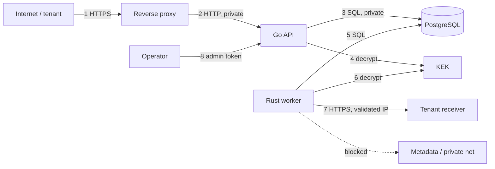

# Threat model

Status: Implemented and verified through Phase 5. Last updated: 2026-10-23.
All registration-time and connect-time SSRF controls, hashed API keys, AES-256-GCM encrypted signing
secrets, per-attempt lease-token fencing, rate limiters, log-redaction canary tests, and SQL injection
corpus tests are implemented and verified in [14-phase-3-report.md](14-phase-3-report.md),
[15-phase-4-report.md](15-phase-4-report.md), and [16-phase-5-report.md](16-phase-5-report.md).
Method: asset/actor inventory, trust boundaries, STRIDE per component, then abuse-case analysis for the
highest-risk features (webhook SSRF, event injection, credential theft, tenant isolation). This is a
design document, not a certification or a claim of complete protection.

## 1. Assets

| Asset | Why it matters | Where it lives |
| --- | --- | --- |
| Event payloads | May contain PII, order data, financial data | PostgreSQL (`events.payload`, `wire_body`) |
| Signing secrets | Forge deliveries to a tenant's receiver | PostgreSQL ciphertext; worker memory |
| API key digests | Tenant authentication | PostgreSQL; plaintext only at issuance |
| Tenant boundary | Prevent cross-tenant reads/writes | Every query, every handler |
| Audit log | Investigative evidence | PostgreSQL append-only |
| Delivery history | Incident reconstruction | `deliveries`, `delivery_attempts` |
| Infrastructure credentials | DB, KEK, admin token | Deployment secret manager/env |
| Availability | Ingest and delivery are business-critical | API, DB, workers |

## 2. Actors and capabilities

| Actor | Capability | Trust |
| --- | --- | --- |
| Legitimate tenant engineer | Holds an API key; controls endpoints and receiver | Authenticated, not trusted for other tenants |
| Malicious tenant | Can register URLs, send payloads, attempt cross-tenant access | Authenticated, hostile |
| External attacker | No key; can reach public endpoints, send malformed traffic | Untrusted |
| Malicious/compromised receiver | Controls responses, can be slow, can redirect, can attempt to induce retries | Untrusted |
| Compromised dependency | Supply-chain code execution in build or runtime | Untrusted until verified |
| Insider/operator | Admin token, DB access, KEK access | Privileged; audited imperfectly |
| Cloud metadata service | Holds instance credentials | Must be unreachable from workers |

## 3. Trust boundaries

| # | Boundary | Primary controls | Residual risk |
| --- | --- | --- | --- |
| 1 | Internet → proxy | TLS, WAF/body cap, rate limit | DDoS beyond app controls |
| 2 | Proxy → API | Private network, trusted headers only from proxy | Misconfigured proxy can spoof client IP |
| 3 | API → DB | Least-privilege role, parameterised SQL, private net | DB compromise is game over |
| 4/6 | Services → KEK | Secret manager, process memory | Shared KEK expands blast radius |
| 5 | Worker → DB | Separate role, read/write limited | Worker can read all tenants' secrets |
| 7 | Worker → internet | SSRF connect-time check, no proxy/redirects, egress policy | Public proxies, future ranges |
| 8 | Operator → admin | Separate listener, token, network policy, audit | Token theft gives broad power |

## 4. STRIDE analysis

### 4.1 Go API

| Category | Threat | Mitigation | Verification |
| --- | --- | --- | --- |
| Spoofing | Stolen API key used by attacker | 256-bit keys, hashed at rest, rotation/revocation, audit, optional expiry, last-used visibility | Auth tests, revocation tests |
| Spoofing | Forged `X-Forwarded-For` to bypass IP limits | Trust proxy only when configured; use socket address otherwise | Middleware test |
| Tampering | Mass assignment of `tenant_id`, `status`, `role` in JSON | Explicit request DTOs; no direct struct binding to DB rows; server-controlled fields ignored/rejected | Contract tests |
| Tampering | SQL injection via filters/sort/cursor | Parameterised queries; allowlisted sort fields; validated cursor | Injection tests, code review |
| Repudiation | Tenant denies creating a key/rotating a secret | Append-only audit with actor, request ID, IP, timestamp | Audit tests |
| Information disclosure | Cross-tenant read via guessed UUID | Tenant predicate in every query; `404`; no sequential IDs | Cross-tenant matrix tests |
| Information disclosure | Secrets in logs/errors | Redaction, no payload logging, generic errors, `Cache-Control: no-store` | Canary-value log tests |
| Denial of service | Huge payload / deeply nested JSON | `MaxBytesReader`, 256 KiB cap, JSON depth/size checks, timeouts | Oversize/deep-nesting tests |
| Denial of service | Expensive pagination / unbounded filters | Limit ≤ 100, 90-day range, allowlisted filters, keyset pagination | Bounded query tests |
| Elevation | `ingest` key calling management endpoints | Central role middleware; default deny | Role matrix tests |
| Elevation | Last owner key revoked, tenant locked out | Refuse last-owner revocation | Test |

### 4.2 Rust worker

| Category | Threat | Mitigation | Verification |
| --- | --- | --- | --- |
| Spoofing | Receiver impersonation | TLS verification, HMAC signature, no insecure TLS option | TLS test with self-signed cert fails |
| Tampering | Payload altered in transit | TLS + HMAC over raw body | Signature tests |
| Tampering | SSRF via DNS rebinding | Connect-time resolver validates exact addresses | Controlled resolver test |
| Information disclosure | Secret in logs/panic | Secrets wrapped, no Debug of plaintext, redacted errors | Log capture test |
| Information disclosure | Full response body logged | Stream and discard; only status/Retry-After used | Code review + test |
| Denial of service | Slowloris / infinite response | connect/read/total timeouts, 8 KiB body cap, concurrency cap | Slow-receiver tests |
| Denial of service | One destination starves others | Per-destination concurrency + rate limits, global semaphore | Fairness test |
| Elevation | Malicious worker input (DB row) causes code execution | No `unsafe`, serde parsing, bounded lengths, no shell | Clippy, fuzz |
| Repudiation | Worker action not attributable | `worker_id`, attempt rows, lease token, audit for admin replay | Attempt history tests |
| Tampering | Stale worker overwrites newer state | Lease-token fencing on every completion | Stale-completion test |

### 4.3 Database

| Category | Threat | Mitigation |
| --- | --- | --- |
| Tampering | Application bug writes cross-tenant rows | `tenant_id` FK + application predicates + integration tests; RLS deferred with rationale |
| Tampering | Replay/delivery history rewritten | Append-only attempts, no update/delete API, restricted grants |
| Information disclosure | Backup/disk exposure | Encryption at rest at the infrastructure layer; not implemented by the app (documented assumption) |
| Denial of service | Long transactions, lock contention | Statement/lock/idle timeouts, no HTTP in tx, bounded batches, autovacuum tuning |
| Repudiation | Audit rows deleted | API role has INSERT/SELECT only on `audit_logs`; retention job is separate |

## 5. Abuse-case analysis: SSRF (highest risk)

### 5.1 Attack paths considered

1. `https://127.0.0.1/`, `https://[::1]/` → loopback services.
2. `https://169.254.169.254/latest/meta-data/` → cloud credentials.
3. `https://10.0.0.0/8`, `172.16/12`, `192.168/16`, `fc00::/7` → internal networks.
4. Decimal/octal/hex/shorthand IP encodings → parser bypass.
5. IPv4-mapped IPv6, NAT64, 6to4, Teredo → address-family bypass.
6. Hostname resolving to a private address, or split answers (public + private).
7. DNS rebinding: registration resolves public, delivery resolves private.
8. Redirect from a public URL to `http://169.254.169.254/`.
9. `HTTP_PROXY`/OS proxy causing the platform to connect through an attacker-controlled proxy.
10. Userinfo/authority confusion (`https://example.com@evil.com`, backslashes).
11. Single-label internal names (`metadata`, `localhost`).
12. Port scanning internal hosts on non-HTTP ports.
13. Cloud metadata hostnames (`metadata.google.internal`).
14. Public host that is itself an open proxy to internal networks.

### 5.2 Defense in depth

| Layer | Control | Proves |
| --- | --- | --- |
| URL parsing | WHATWG-compatible parser, reject ambiguous authority, userinfo, fragments, trailing dots | Reduces parser-confusion bypasses |
| Scheme/port | HTTPS only, port 443 allowlist | No `file:`, `gopher:`, arbitrary ports |
| Host | Require FQDN, deny internal suffixes | Blocks single-label/internal names before DNS |
| DNS | Resolve A+AAAA, reject if **any** address is non-global, bounded timeout | Blocks private/split answers |
| IP | IANA-based deny list, IPv6 only `2000::/3`, reject transition ranges | Blocks loopback/private/metadata/multicast |
| Connect | Custom resolver returns validated addresses; client connects to those | Closes rebinding TOCTOU |
| HTTP | Redirects `none`, proxies `no_proxy`, no cookies, TLS verification mandatory | Blocks redirect/proxy bypass |
| Response | 8 KiB cap, discard body, no logging | Limits data exfiltration and memory abuse |
| Network | Default-deny egress; no metadata route; optional egress proxy | Survives application bugs |
| Detection | `relayforge_ssrf_blocks_total`, alert on spikes; audit registration rejections | Detects probing |

### 5.3 Explicit non-guarantees

- A tenant can point at a public service they control and use it to proxy elsewhere. RelayForge cannot
  distinguish that from a legitimate receiver.
- The system resolver can be compromised; TLS certificate validation still binds the hostname, but the
  resolved address is only as trustworthy as DNS.
- Future IANA special-purpose ranges are not blocked until the list is updated.
- Compose networking is not equivalent to production egress control. Tests prove the application layer
  only.

## 6. Secrets and credential handling

| Control | Implementation | Limitation |
| --- | --- | --- |
| API key entropy | 32 random bytes, OS CSPRNG | Compromise of the client is out of scope |
| API key storage | HMAC-SHA256(pepper, secret), 32-byte digest; public `key_id` lookup | Pepper compromise + DB dump enables offline guessing only for weak keys (keys are 256-bit) |
| Comparison | Constant-time (`hmac.Equal`) | Timing of the key-ID lookup is not fully constant; IDs are public handles |
| Signing secret storage | AES-256-GCM, versioned KEK, AAD binds tenant/endpoint/secret/version | KEK shared by API and worker |
| Secret display | Once, in create/rotate response | Lost secret requires rotation |
| Rotation | Overlap ≤ 7 days, max 2 active, sign with all | Compromised secret valid during overlap |
| Revocation | Immediate retirement | In-flight attempts may already be on the wire |
| Logging | Allowlist fields; canary tests; no headers/body | A future code change can regress this; test must remain |
| Error bodies | Generic; request ID only | Support access to logs is a separate trust boundary |
| Admin token | ≥ 32 bytes, constant-time compare, internal listener | Static token; rotation requires redeploy |

Crypto choices: standard library primitives only (Go `crypto/hmac`, `crypto/aes`, `crypto/cipher`,
`crypto/rand`; Rust `hmac`, `sha2`, `aes-gcm`, `rand`/`getrandom`). No custom constructions. AEAD nonces are
random 96-bit per encryption; the number of secrets per endpoint is tiny, so collision probability is
negligible. KEK rotation re-encrypts rows in a batched job (Phase 4).

## 7. Multi-tenancy

Primary control is structural:

- `tenant_id` on every tenant-owned table.
- Repository methods require a tenant ID; there is no “list all” method exposed to handlers.
- Path IDs are resolved with `WHERE id = $1 AND tenant_id = $2`; miss → `404`.
- IDs are UUIDv7, not enumerable, but that is not the control.
- Fan-out selects endpoints by `tenant_id` and active status.
- The worker queries across tenants only for claiming; it never returns tenant data through a tenant API.
- Audit queries are tenant-scoped for tenant roles; admin sees all.

RLS is not enabled in v1. The rationale and the conditions for enabling it are in
[docs/02-data-model.md §7](02-data-model.md). The honest position: application-level isolation is only as
good as the tests and code review; there is no database-enforced backstop yet.

## 8. Availability and abuse

| Threat | Control | Residual |
| --- | --- | --- |
| Ingest flood | Per-tenant fixed-window limit, body cap, DB pool cap, statement timeout | Distributed tenants can still consume shared DB |
| Signup flood | Per-IP 5/min, optional signup token, tenant caps | Botnets |
| Slow receiver | Per-attempt timeouts, bounded concurrency, per-destination cap | Many slow destinations can occupy slots; rate limits mitigate |
| Retry storm | Exponential backoff + jitter, max attempts, retry window, destination rate limit | Synchronised retries after outage are spread but still bursty |
| Queue backlog | Queue-age metric, alert, horizontal workers, claim batching | Single primary bottleneck |
| Large payload | 256 KiB cap, `MaxBytesReader`, DB check | Many 256 KiB events increase I/O; per-tenant rate limits bound |
| Deep JSON | Decoder limits + depth check | Go decoder is recursive; depth limit required |
| Log flooding | No body logging, bounded error detail, sampling for access logs if needed | Error storms still produce volume |
| Admin abuse | Token, network restriction, audit | Insider risk |

## 9. Supply chain and build

- Go modules and Cargo crates pinned via `go.sum`/`Cargo.lock`; Dependabot/Renovate optional.
- CI runs `govulncheck`, `cargo audit`, and a container scan (Trivy) on built images.
- GitHub Actions pinned by commit SHA; least-privilege `permissions:`; no secrets in PR workflows.
- Docker images: multi-stage, non-root, read-only root filesystem where possible, no shell in runtime
  image, pinned base digests.
- Secret scanning (gitleaks) and a pre-commit hook are Phase 1/4 deliverables.
- Build provenance/SBOM is future work (not claimed).

## 10. What an attacker still gains if a component falls

| Compromise | Consequence | Limiting factor |
| --- | --- | --- |
| One tenant API key | Full control of that tenant's endpoints/events | Tenant scope; revocation; audit |
| One endpoint signing secret | Forge deliveries to that receiver | Per-endpoint secret; rotation |
| Worker process | Read payloads/secrets for all tenants; send deliveries | No public listener; egress policy; no admin token |
| API process | All tenant data via DB role; KEK access | DB least privilege; network isolation |
| Database | All data and ciphertext; not KEK | KEK in separate secret store (deployment-dependent) |
| KEK + DB | All signing secrets in plaintext | KEK rotation/incident response |
| Admin token | Suspend tenants, replay, inspect queue | Internal listener, network policy, audit |

## 11. Security requirements traceability

| Requirement | Design | Test (Phase 5) |
| --- | --- | --- |
| Secure API key generation | 32 random bytes, key ID + digest | Entropy/format/uniqueness |
| Credential hashes | HMAC-SHA256 + constant-time compare | Digest-only DB assertion, timing-safe helper test |
| HMAC signing | Signature v1 spec | Published vector, tamper, rotation |
| Timestamp replay protection | 300 s window + receiver dedupe | Stale/future timestamp tests, duplicate test |
| Secret rotation | Overlap, max 2, sign all | Both secrets accepted; retired rejected |
| Tenant isolation | Tenant predicate + 404 | Full cross-tenant matrix |
| Request validation | DTOs, size/depth limits, strict fields | Fuzz + oversize |
| SQL injection | Parameterised queries | Injection payload corpus |
| Rate limiting | Tenant/IP/destination limiters | Burst tests, `Retry-After` |
| Redaction | Structured logs + canaries | Canary secret/key/payload absence |
| Safe errors | RFC 9457, no internals | Error-body assertions |
| SSRF | Connect-time policy | Shared vectors + rebinding + redirect |
| Dependency scanning | CI jobs | CI output (Phase 1+) |
| Admin protection | Internal listener + token | Network/authorization tests |

## 12. Residual risks and open questions

1. **Shared KEK.** API and worker both decrypt signing secrets. A worker compromise exposes all tenants'
   secrets. A KMS/signing service would reduce this but adds a dependency and latency; deferred with an ADR.
2. **No RLS.** Application isolation has no database backstop.
3. **Duplicate delivery.** Inherent; receiver dedupe is mandatory. The demo proves the pattern, not every
   customer's implementation.
4. **Egress enforcement is deployment-specific.** Application tests cannot prove network policy.
5. **Public proxy destinations.** SSRF controls cannot identify an open proxy on a public IP.
6. **Tenant deletion/GDPR erasure.** Not implemented; retention is the only deletion mechanism.
7. **Admin token rotation.** Static env token; no per-operator identity.
8. **Audit immutability.** Append-only by grant, but a DB superuser can modify rows. True WORM storage is
   out of scope.
9. **Backups.** Encryption and restore testing are deployment responsibilities, not application features.
10. **Timing side channels.** Key-ID lookup is not fully constant-time; the key space makes practical
    exploitation implausible, but this is not formally proven.
11. **JSON parser differentials.** Signature covers raw bytes, so a receiver that re-serialises fails
    closed. Our own parser is Go's `encoding/json`; no cross-language parsing of payload is required.
12. **Denial of service via legitimate load.** Rate limits are per tenant; a coordinated group of tenants
    can saturate the shared DB. Capacity planning and per-IP signup controls are partial.

## 13. Security references

- OWASP SSRF Prevention Cheat Sheet (connect-time validation, DNS rebinding, deny list).
- OWASP Webhook Security Cheat Sheet (signature, timestamp, rotation, replay, idempotency).
- OWASP Logging, Secrets Management, Multi-Tenant Security, and Authorization Cheat Sheets.
- OWASP ASVS 5.0 (authentication, access control, validation, crypto, logging).
- IANA IPv4/IPv6 Special-Purpose Address Registries.
- RFC 2104 (HMAC), FIPS 180-4 (SHA-256), RFC 8446 (TLS 1.3), RFC 9110 (HTTP semantics),
  RFC 6585 (429), RFC 9457 (problem details).
- PostgreSQL 18 documentation: `SELECT` locking clause, constraints, indexes, RLS.

Citations and retrieval dates: [docs/10-research-sources.md](10-research-sources.md).
